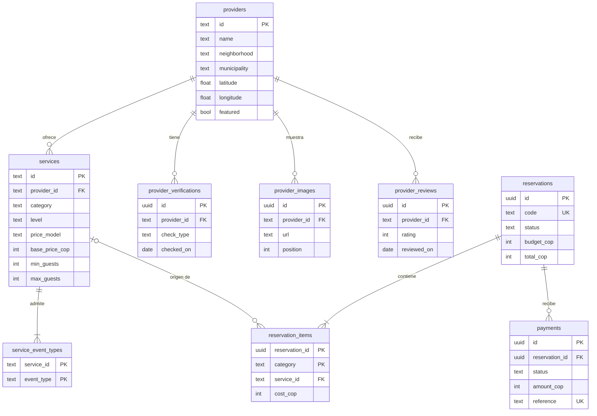
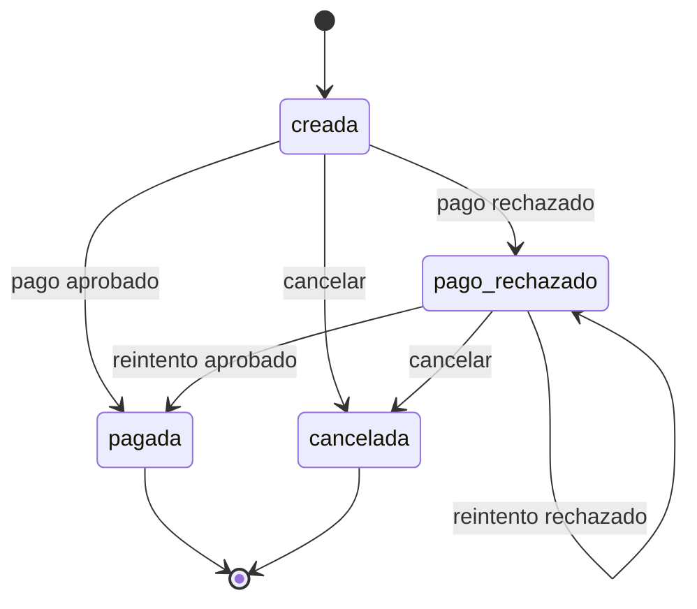

# Diseño de Base de Datos — EventU (EU)

| Campo | Valor |
|---|---|
| Proyecto | EventU: aplicación móvil que convierte un presupuesto en paquetes de servicios para eventos sociales en Cali |
| Fuentes | SRS v2.0, SAD (ADR-04, ADR-06, ADR-09, ADR-10 a ADR-12, §6 y §7) y Product Backlog v2 |
| Versión | 2.0 — incorpora el cambio CR-01 (marketplace): coordenadas, destacados, fotos, reseñas y calificación derivada |
| Fecha | 7 de noviembre de 2026 |
| Motor | PostgreSQL 16; el DDL es compatible con SQLite salvo la sección final «SOLO POSTGRESQL» |
| Archivos asociados | `schema.sql`, `seed.sql` y `seed.json` (los mismos datos de la sección 9) |
| Verificación realizada | `schema.sql` y `seed.sql` se ejecutaron sin errores en PostgreSQL 16 y en SQLite; se probaron las restricciones (§4) |

## 1. Resumen del dominio

| Dominio | Entidades | Propósito |
|---|---|---|
| Catálogo | `providers`, `services`, `service_event_types` | Oferta curada de Cali: quién ofrece qué, a qué precio y para qué eventos y tamaños |
| Verificación | `provider_verifications` (y la vista `v_providers`) | Comprobaciones documentadas que sustentan el estado «verificado» (RN-07) |
| Reserva | `reservations`, `reservation_items` | Paquete elegido con instantánea de servicios y precios, y datos de contacto (RN-08) |
| Exploración | `provider_images`, `provider_reviews` y las columnas `latitude`, `longitude` y `featured` de `providers` | Galería, reseñas de solo lectura, ubicación y destacados para el marketplace (RF-EXP) |
| Pago | `payments` | Resultado del pago simulado (RN-09); nunca datos de tarjeta |

**Decisiones por defecto («Propuesto»; no hubo preguntas bloqueantes)**
1. Los paquetes recomendados **no se persisten**: se calculan al vuelo (SAD §6). Solo se guarda el paquete elegido dentro de la reserva.
2. Un servicio pertenece a **un solo proveedor**.
3. Hay dos modelos de precio: `fijo` (por evento) y `por_invitado`; el costo se calcula como en RN-15.
4. Las enumeraciones usan `CHECK` en lugar de `CREATE TYPE`, para que el mismo DDL funcione en SQLite y PostgreSQL.
5. El estado de verificación se **deriva** de las comprobaciones (vista `v_providers`); no se guarda como columna para que nunca contradiga las comprobaciones.
6. Los identificadores del catálogo son *slugs* legibles (`prv-…`, `svc-…`); reservas, pagos y comprobaciones usan UUID generados por la aplicación. La reserva se consulta por su `code`.
7. El tipo de evento «otro» no se incluye porque el SRS no lo pide.
8. La calificación (`rating_avg`, `rating_count`) se **deriva** de `provider_reviews` en la vista `v_providers`; no se guarda como columna (igual que la verificación).
9. El «precio desde» de una tarjeta **no se guarda**: lo calcula el API con el costo de cada servicio elegible (RN-25).
10. Las fotos se guardan como URL de un banco de imágenes (`https://`); la aplicación no almacena archivos.
11. Las reseñas son datos de ejemplo de solo lectura; no hay alta de reseñas en el MVP (supuesto S-05).
12. Una reserva puede no tener presupuesto (`budget_cop` nulo) cuando nace de «Mi evento», y su `modality` puede ser `personalizado` (RN-21, RN-22).
13. **Migración inicial única:** como el proyecto aún no se despliega, `0001_initial` ya incluye estos cambios. Quien haya creado una base local con la versión 1 debe borrarla y recrearla.

## 2. Entidades y atributos

### 2.1 `providers`
| Columna | Tipo | Nulo | Defecto | Descripción | Origen |
|---|---|---|---|---|---|
| id | TEXT (PK) | No | — | Slug del proveedor | RF-PRO-01 |
| name | TEXT | No | — | Nombre comercial | RF-PRO-02 |
| description | TEXT | No | — | Alcance del servicio | RF-PRO-02 |
| neighborhood | TEXT | No | — | Barrio | RF-PRO-03 |
| municipality | TEXT | No | — | Municipio del área metropolitana | RF-PRO-03 |
| phone | TEXT | No | — | Teléfono de contacto (de ejemplo en la semilla) | RF-PRO-04 |
| email | TEXT | No | — | Correo de contacto (de ejemplo en la semilla) | RF-PRO-04 |
| latitude | DOUBLE PRECISION | Sí | — | Latitud aproximada (3 decimales ≈ 100 m) | RF-EXP-09, RN-28 |
| longitude | DOUBLE PRECISION | Sí | — | Longitud aproximada; nula si y solo si `latitude` es nula | RF-EXP-09, RN-28 |
| featured | BOOLEAN | No | FALSE | Aparece en «Destacados» del Inicio | RF-EXP-02 |
| created_at | TIMESTAMPTZ | No | CURRENT_TIMESTAMP | Fecha de alta | — |

### 2.2 `provider_verifications`
| Columna | Tipo | Nulo | Defecto | Descripción | Origen |
|---|---|---|---|---|---|
| id | UUID (PK) | No | app (uuid4) | Identificador | RN-07 |
| provider_id | TEXT (FK) | No | — | Proveedor comprobado | RF-PRO-04 |
| check_type | TEXT | No | — | `identidad`, `registro_mercantil`, `visita` o `referencias` (Propuesto) | RN-07 |
| checked_on | DATE | No | — | Fecha de la comprobación | RF-PRO-05 |
| notes | TEXT | No | — | Constancia documentada | RN-07 |

La vista `v_providers` añade `verification_status` (`verificado` si existe al menos una comprobación y `en_revision` en caso contrario), `rating_avg` (promedio de las reseñas con un decimal, nulo si no hay) y `rating_count`.

### 2.3 `services`
| Columna | Tipo | Nulo | Defecto | Descripción | Origen |
|---|---|---|---|---|---|
| id | TEXT (PK) | No | — | Slug del servicio | RF-CAT-01 |
| provider_id | TEXT (FK) | No | — | Proveedor que lo ofrece | RF-CAT-01 |
| category | TEXT | No | — | `espacio`, `alimentacion`, `decoracion` o `entretenimiento` | RF-CAT-02, RN-03 |
| level | TEXT | No | — | Modalidad sugerida: `ahorro`, `equilibrado` o `premium` | RN-02, RN-13 |
| name | TEXT | No | — | Nombre del servicio | RF-CAT-01 |
| description | TEXT | No | — | Descripción | RF-CAT-01 |
| price_model | TEXT | No | — | `fijo` o `por_invitado` | RN-15 |
| base_price_cop | INTEGER | No | — | Precio base en COP, mayor que 0 | RN-04 |
| min_guests | INTEGER | No | — | Capacidad mínima | RN-14 |
| max_guests | INTEGER | No | — | Capacidad máxima (mayor o igual que la mínima) | RN-14 |

### 2.4 `service_event_types`
| Columna | Tipo | Nulo | Defecto | Descripción | Origen |
|---|---|---|---|---|---|
| service_id | TEXT (PK, FK) | No | — | Servicio | RN-14 |
| event_type | TEXT (PK) | No | — | `cumpleanos`, `boda` o `xv` | RN-14, RF-CAT-03 |

### 2.5 `reservations`
| Columna | Tipo | Nulo | Defecto | Descripción | Origen |
|---|---|---|---|---|---|
| id | UUID (PK) | No | app (uuid4) | Identificador interno | RF-RES-01 |
| code | TEXT (único) | No | — | Número de reserva `EU-` + 6 caracteres (Propuesto) | RN-18, RF-CNF-01 |
| status | TEXT | No | `creada` | `creada`, `pagada`, `pago_rechazado` o `cancelada` | RF-RES-06, RF-PAG-03 |
| event_type | TEXT | No | — | Tipo de evento | RF-REC-01 |
| guests | INTEGER | No | — | Invitados, mayor que 0 (rango 1–500 lo valida la app) | RF-REC-01, RN-19 |
| budget_cop | INTEGER | Sí | — | Presupuesto, si el usuario lo ingresó; nulo en una reserva armada sin presupuesto | RF-REC-01, RN-22 |
| modality | TEXT | No | — | Origen: `ahorro`, `equilibrado`, `premium` (paquete sin cambios) o `personalizado` | RN-02, RN-21 |
| total_cop | INTEGER | No | — | Total; igual a la suma de los ítems | RN-04 |
| customer_name | TEXT | No | — | Nombre del cliente | RF-RES-02, RNF-SEG-05 |
| customer_email | TEXT | No | — | Correo del cliente | RF-RES-02, RNF-SEG-05 |
| customer_phone | TEXT | No | — | Teléfono del cliente | RF-RES-02, RNF-SEG-05 |
| event_date | DATE | No | — | Fecha del evento, posterior a hoy (validado por la app) | RN-20 |
| created_at | TIMESTAMPTZ | No | CURRENT_TIMESTAMP | Creación | — |
| updated_at | TIMESTAMPTZ | No | CURRENT_TIMESTAMP | Último cambio de estado (lo fija la app) | RF-RES-06 |

`total_cop` es un dato derivado que se guarda a propósito: la reserva es una instantánea inmutable (RN-08) y la API la lee a menudo. Su coherencia con los ítems la garantiza la restricción de §4.

### 2.6 `reservation_items`
| Columna | Tipo | Nulo | Defecto | Descripción | Origen |
|---|---|---|---|---|---|
| reservation_id | UUID (PK, FK) | No | — | Reserva | RN-08 |
| category | TEXT (PK) | No | — | Rubro; un servicio por rubro y reserva | RN-03 |
| service_id | TEXT (FK) | Sí | — | Servicio de origen; queda nulo si el servicio se retira del catálogo | RN-08 |
| service_name | TEXT | No | — | Nombre al reservar | RN-08 |
| provider_name | TEXT | No | — | Proveedor al reservar | RN-08 |
| price_model | TEXT | No | — | Modelo de precio al reservar | RN-15 |
| unit_price_cop | INTEGER | No | — | Precio base al reservar | RN-08 |
| cost_cop | INTEGER | No | — | Costo aplicado (fijo, o precio por invitados) | RN-04, RN-15 |

### 2.7 `payments`
| Columna | Tipo | Nulo | Defecto | Descripción | Origen |
|---|---|---|---|---|---|
| id | UUID (PK) | No | app (uuid4) | Identificador | RF-PAG-03 |
| reservation_id | UUID (FK) | No | — | Reserva pagada | RF-PAG-03 |
| status | TEXT | No | — | `aprobado` o `rechazado` | RN-09 |
| amount_cop | INTEGER | No | — | Monto, mayor que 0 | RF-PAG-01 |
| reference | TEXT (único) | No | — | Referencia simulada, por ejemplo `SIM-…` | RN-09 |
| created_at | TIMESTAMPTZ | No | CURRENT_TIMESTAMP | Fecha del intento | RF-PAG-03 |

Una reserva puede tener varios intentos (rechazados) y a lo sumo uno aprobado. No existe ninguna columna de tarjeta (RNF-SEG-02).

### 2.8 `provider_images`
| Columna | Tipo | Nulo | Defecto | Descripción | Origen |
|---|---|---|---|---|---|
| id | UUID (PK) | No | app (uuid4) | Identificador | RF-EXP-05 |
| provider_id | TEXT (FK) | No | — | Proveedor dueño de la foto | RF-EXP-05 |
| url | TEXT | No | — | URL `https://` de la imagen | RF-EXP-05 |
| alt_text | TEXT | No | — | Texto alternativo de la imagen | RNF-USA |
| position | INTEGER | No | — | Orden en la galería; 1 es la foto principal; único por proveedor | RF-EXP-05 |

### 2.9 `provider_reviews`
| Columna | Tipo | Nulo | Defecto | Descripción | Origen |
|---|---|---|---|---|---|
| id | UUID (PK) | No | app (uuid4) | Identificador | RF-EXP-06 |
| provider_id | TEXT (FK) | No | — | Proveedor reseñado | RF-EXP-06 |
| author_name | TEXT | No | — | Nombre corto del autor (ficticio en la semilla) | RF-EXP-06 |
| rating | INTEGER | No | — | Puntaje de 1 a 5 | RF-EXP-06, RN-24 |
| comment | TEXT | No | — | Comentario, hasta 500 caracteres | RF-EXP-06 |
| reviewed_on | DATE | No | — | Fecha de la reseña | RF-EXP-06 |

## 3. Diagrama entidad-relación



## 4. Reglas de integridad y restricciones

| Tipo | Restricción | Dónde se valida |
|---|---|---|
| PK | Todas las tablas; `service_event_types` y `reservation_items` con clave compuesta | BD |
| FK | `services.provider_id` → `providers` **RESTRICT** (no se borra un proveedor con servicios) | BD |
| FK | `provider_verifications.provider_id`, `provider_images.provider_id` y `provider_reviews.provider_id` → `providers` **CASCADE** | BD |
| FK | `service_event_types.service_id` → `services` **CASCADE** | BD |
| FK | `reservation_items.reservation_id` → `reservations` **CASCADE** | BD |
| FK | `reservation_items.service_id` → `services` **SET NULL** (la copia de la reserva sobrevive) | BD |
| FK | `payments.reservation_id` → `reservations` **RESTRICT** (no se borra una reserva con pagos) | BD |
| UNIQUE | `reservations.code`, `payments.reference` | BD |
| UNIQUE parcial | Un solo pago `aprobado` por reserva (`ux_payments_one_approved`) | BD |
| CHECK | Precios y montos > 0; `unit_price_cop` > 0; `cost_cop` ≥ 0; `guests` > 0; `min_guests` ≥ 1 y `max_guests` ≥ `min_guests` | BD |
| CHECK | Enumeraciones: rubro, nivel, modelo de precio, tipo de evento, modalidad, estado de reserva, estado de pago, tipo de comprobación | BD |
| CHECK | `budget_cop` nulo o `total_cop` ≤ `budget_cop` (RN-01, RN-22) | BD |
| CHECK | `latitude` y `longitude` ambas nulas o ambas presentes y en rango; `rating` entre 1 y 5; `url` con prefijo `https://` | BD |
| UNIQUE | `(provider_id, position)` en `provider_images` | BD |
| CHECK | `code` con 9 caracteres y prefijo `EU-` (RN-18) | BD |
| Trigger diferido (solo PostgreSQL) | `total_cop` = suma de `reservation_items.cost_cop` (RN-04) | BD en PostgreSQL; en SQLite lo valida la app |
| Aplicación | Rangos de entrada (presupuesto 1.000.000–50.000.000 e invitados 1–500, RN-19 Propuesto); fecha del evento posterior a hoy (RN-20); formato del teléfono; formato aleatorio del código; transiciones de estado válidas; `cost_cop` = precio × invitados (RN-15); la regla «ningún paquete supera el presupuesto» al recomendar (RN-01) | App |
| Aplicación | Una reserva `pagada` solo con un pago `aprobado`; solo reservas `creada` o `pago_rechazado` aceptan pago; solo las `pagada` muestran la confirmación | App |

Se dejan en la aplicación los rangos y formatos marcados como Propuesto, para poder cambiarlos sin migración.

## 5. Índices

| Tabla | Columnas | Motivo | Consulta que acelera |
|---|---|---|---|
| services | (category, level) | Filtrar por rubro y nivel | Catálogo y servicios elegibles |
| services | (provider_id) | FK y servicios de un proveedor | Ficha del proveedor |
| service_event_types | (event_type, service_id) | Servicios admitidos por tipo de evento | Catálogo y elegibles |
| provider_verifications | (provider_id) | Estado de verificación y comprobaciones | `v_providers` y ficha |
| provider_reviews | (provider_id) | Calificación derivada y lista de reseñas | `v_providers` y ficha |
| providers | (latitude, longitude) | Filtrar por zona del mapa | `GET /providers?bbox=` |
| providers | (featured) | Destacados del Inicio | `GET /home` |
| payments | (reservation_id) | Pagos de una reserva | Confirmación y detalle de reserva |
| payments | UNIQUE parcial (reservation_id) donde status = 'aprobado' | Un solo pago aprobado | Inserción de pagos |
| reservations | UNIQUE (code) | Consulta por número | `GET /reservations/{code}` |
| payments | UNIQUE (reference) | Referencia única | Inserción de pagos |

Con unas pocas decenas de servicios los índices son casi irrelevantes; se dejan los necesarios para las claves y las consultas del API.

## 6. Estados y transiciones



El pago tiene dos estados finales, `aprobado` y `rechazado`; cada intento es una fila nueva en `payments` y una reserva tiene a lo sumo un intento aprobado.

## 7. Reglas de negocio reflejadas en datos

| RN | Reflejo en la BD |
|---|---|
| RN-01 | `ck_reservations_budget`: `total_cop` ≤ `budget_cop` cuando hay presupuesto (la regla al recomendar la aplica el dominio) |
| RN-02 | `services.level` y `reservations.modality` con tres valores |
| RN-03 | `services.category` con cuatro rubros y `PK (reservation_id, category)`: un servicio por rubro |
| RN-04 | `total_cop` y trigger diferido; importes enteros `*_cop` |
| RN-05 | No se guarda: restante = `budget_cop` − `total_cop` (derivado) |
| RN-07 | `provider_verifications` y `v_providers` |
| RN-08 | `reservation_items` con copia de nombre, proveedor y precio |
| RN-09 | `payments` sin columnas de tarjeta; `reference` simulada |
| RN-10 | La semilla está marcada como dato de ejemplo |
| RN-14 | `service_event_types` y `min_guests`/`max_guests` |
| RN-15 | `services.price_model`; `reservation_items.cost_cop` |
| RN-17 | No se guarda ninguna tarjeta; la regla vive en `SimulatedGateway` |
| RN-18 | `reservations.code` único con CHECK de longitud y prefijo |
| RN-19, RN-20 | Validados por la aplicación |
| RN-21, RN-22 | `reservations.modality` admite `personalizado`; `budget_cop` es opcional |
| RN-23 | `PK (reservation_id, category)` y regla de mínimo en la aplicación |
| RN-24 | `v_providers.rating_avg` y `rating_count` derivados de `provider_reviews` |
| RN-25, RN-26 | Calculados por el API (precio desde y orden); no se guardan |
| RN-27 | `provider_reviews` sin endpoint de escritura |
| RN-28 | `providers.latitude`/`longitude` aproximadas con 3 decimales |

## 8. DDL completo (`schema.sql`)

Diferencias para SQLite: (1) no se ejecuta la sección «SOLO POSTGRESQL» (la suma de ítems la valida la app); (2) los UUID los genera la aplicación (`uuid4`), por eso las columnas `id` de tipo UUID no tienen valor por defecto en la BD; (3) activar `PRAGMA foreign_keys = ON` en cada conexión; (4) `TIMESTAMPTZ` se almacena como texto.

```sql
-- =====================================================================
-- EventU (EU) - schema.sql  (PostgreSQL 16; compatible con SQLite salvo la
-- sección final "SOLO POSTGRESQL")
-- Convenciones: nombres en inglés snake_case; dinero en COP enteros (*_cop);
-- enumeraciones con CHECK (portables); sin columnas de tarjeta.
-- Diferencias para SQLite: ver la sección 8 del documento (UUID se genera en
-- la aplicación; se omite la sección "SOLO POSTGRESQL").
-- =====================================================================

-- ---------------------------------------------------------------------
-- Catálogo: proveedores
-- ---------------------------------------------------------------------
CREATE TABLE providers (
    id            TEXT PRIMARY KEY CHECK (length(id) BETWEEN 3 AND 80),   -- slug legible
    name          TEXT NOT NULL CHECK (length(name) BETWEEN 1 AND 100),
    description   TEXT NOT NULL,                                          -- alcance del servicio (RF-PRO-02)
    neighborhood  TEXT NOT NULL,                                          -- barrio (RF-PRO-03)
    municipality  TEXT NOT NULL,                                          -- municipio (RF-PRO-03)
    phone         TEXT NOT NULL,                                          -- contacto (RF-PRO-04)
    email         TEXT NOT NULL,                                          -- contacto (RF-PRO-04)
    latitude      DOUBLE PRECISION CHECK (latitude  BETWEEN -90  AND 90),  -- ubicación aproximada (RF-EXP-09)
    longitude     DOUBLE PRECISION CHECK (longitude BETWEEN -180 AND 180),
    featured      BOOLEAN NOT NULL DEFAULT FALSE,                         -- aparece en «Destacados» del Inicio (RF-EXP-02)
    created_at    TIMESTAMPTZ NOT NULL DEFAULT CURRENT_TIMESTAMP,
    CONSTRAINT ck_providers_geo CHECK ((latitude IS NULL) = (longitude IS NULL))   -- ambas o ninguna
);

-- Galería de fotos del proveedor (RF-EXP-05). La URL apunta a un banco de
-- imágenes; la app no guarda archivos.
CREATE TABLE provider_images (
    id           UUID PRIMARY KEY,                                        -- generado por la app (uuid4)
    provider_id  TEXT NOT NULL REFERENCES providers(id) ON DELETE CASCADE,
    url          TEXT NOT NULL CHECK (url LIKE 'https://%'),
    alt_text     TEXT NOT NULL,                                           -- texto alternativo (accesibilidad)
    position     INTEGER NOT NULL CHECK (position >= 1),                  -- 1 = foto principal
    CONSTRAINT ux_provider_images_pos UNIQUE (provider_id, position)
);

-- Reseñas de ejemplo, solo lectura en el MVP (RF-EXP-06, supuesto S-05).
CREATE TABLE provider_reviews (
    id           UUID PRIMARY KEY,                                        -- generado por la app (uuid4)
    provider_id  TEXT NOT NULL REFERENCES providers(id) ON DELETE CASCADE,
    author_name  TEXT NOT NULL CHECK (length(author_name) BETWEEN 1 AND 60),
    rating       INTEGER NOT NULL CHECK (rating BETWEEN 1 AND 5),
    comment      TEXT NOT NULL CHECK (length(comment) BETWEEN 1 AND 500),
    reviewed_on  DATE NOT NULL
);

-- Comprobaciones de verificación (RN-07): un proveedor es "verificado" si
-- tiene al menos una fila aquí; de lo contrario está "en revisión".
CREATE TABLE provider_verifications (
    id           UUID PRIMARY KEY,                                        -- generado por la app (uuid4)
    provider_id  TEXT NOT NULL REFERENCES providers(id) ON DELETE CASCADE,
    check_type   TEXT NOT NULL
                 CHECK (check_type IN ('identidad','registro_mercantil','visita','referencias')),
    checked_on   DATE NOT NULL,
    notes        TEXT NOT NULL                                            -- constancia documentada
);

-- Estado de verificación derivado (evita guardar un estado que pueda
-- contradecir las comprobaciones).
-- La calificación también se deriva de las reseñas (no se guarda como columna).
CREATE VIEW v_providers AS
SELECT p.*,
       CASE WHEN EXISTS (SELECT 1 FROM provider_verifications v WHERE v.provider_id = p.id)
            THEN 'verificado' ELSE 'en_revision' END AS verification_status,
       (SELECT ROUND(AVG(r.rating), 1) FROM provider_reviews r WHERE r.provider_id = p.id) AS rating_avg,
       (SELECT COUNT(*) FROM provider_reviews r WHERE r.provider_id = p.id)                AS rating_count
FROM providers p;

-- ---------------------------------------------------------------------
-- Catálogo: servicios
-- ---------------------------------------------------------------------
CREATE TABLE services (
    id              TEXT PRIMARY KEY CHECK (length(id) BETWEEN 3 AND 120),
    provider_id     TEXT NOT NULL REFERENCES providers(id) ON DELETE RESTRICT,
    category        TEXT NOT NULL
                    CHECK (category IN ('espacio','alimentacion','decoracion','entretenimiento')),
    level           TEXT NOT NULL                                         -- modalidad sugerida (RN-13)
                    CHECK (level IN ('ahorro','equilibrado','premium')),
    name            TEXT NOT NULL CHECK (length(name) BETWEEN 1 AND 120),
    description     TEXT NOT NULL,
    price_model     TEXT NOT NULL CHECK (price_model IN ('fijo','por_invitado')),
    base_price_cop  INTEGER NOT NULL CHECK (base_price_cop > 0),          -- RN-04
    min_guests      INTEGER NOT NULL CHECK (min_guests >= 1),
    max_guests      INTEGER NOT NULL,
    CONSTRAINT ck_services_capacity CHECK (max_guests >= min_guests)      -- RN-14
);

-- Tipos de evento que admite cada servicio (RN-14).
CREATE TABLE service_event_types (
    service_id  TEXT NOT NULL REFERENCES services(id) ON DELETE CASCADE,
    event_type  TEXT NOT NULL CHECK (event_type IN ('cumpleanos','boda','xv')),
    PRIMARY KEY (service_id, event_type)
);

-- ---------------------------------------------------------------------
-- Reservas
-- ---------------------------------------------------------------------
CREATE TABLE reservations (
    id              UUID PRIMARY KEY,                                     -- generado por la app (uuid4)
    code            TEXT NOT NULL UNIQUE                                  -- RN-18: 'EU-' + 6 caracteres
                    CHECK (length(code) = 9 AND substr(code, 1, 3) = 'EU-'),
    status          TEXT NOT NULL DEFAULT 'creada'
                    CHECK (status IN ('creada','pagada','pago_rechazado','cancelada')),
    event_type      TEXT NOT NULL CHECK (event_type IN ('cumpleanos','boda','xv')),
    guests          INTEGER NOT NULL CHECK (guests > 0),                  -- rango 1..500 lo valida la app (RN-19, Propuesto)
    budget_cop      INTEGER CHECK (budget_cop > 0),                       -- opcional en «Mi evento» (RN-22); rango lo valida la app (RN-19, Propuesto)
    modality        TEXT NOT NULL                                         -- origen de la selección (RN-21)
                    CHECK (modality IN ('ahorro','equilibrado','premium','personalizado')),
    total_cop       INTEGER NOT NULL CHECK (total_cop >= 0),              -- = suma de reservation_items.cost_cop (RN-04)
    customer_name   TEXT NOT NULL CHECK (length(customer_name) BETWEEN 1 AND 100),
    customer_email  TEXT NOT NULL CHECK (length(customer_email) BETWEEN 3 AND 254),
    customer_phone  TEXT NOT NULL CHECK (length(customer_phone) > 0),     -- formato lo valida la app (Propuesto)
    event_date      DATE NOT NULL,                                        -- posterior a hoy: lo valida la app (RN-20)
    created_at      TIMESTAMPTZ NOT NULL DEFAULT CURRENT_TIMESTAMP,
    updated_at      TIMESTAMPTZ NOT NULL DEFAULT CURRENT_TIMESTAMP,
    CONSTRAINT ck_reservations_budget CHECK (budget_cop IS NULL OR total_cop <= budget_cop)   -- RN-01
);

-- Instantánea de los servicios y precios al reservar (RN-08). Un servicio
-- por rubro y reserva.
CREATE TABLE reservation_items (
    reservation_id  UUID NOT NULL REFERENCES reservations(id) ON DELETE CASCADE,
    category        TEXT NOT NULL
                    CHECK (category IN ('espacio','alimentacion','decoracion','entretenimiento')),
    service_id      TEXT REFERENCES services(id) ON DELETE SET NULL,      -- la copia sobrevive si el servicio se retira
    service_name    TEXT NOT NULL,
    provider_name   TEXT NOT NULL,
    price_model     TEXT NOT NULL CHECK (price_model IN ('fijo','por_invitado')),
    unit_price_cop  INTEGER NOT NULL CHECK (unit_price_cop > 0),
    cost_cop        INTEGER NOT NULL CHECK (cost_cop >= 0),               -- RN-15: fijo = unit; por_invitado = unit x invitados
    PRIMARY KEY (reservation_id, category)
);

-- ---------------------------------------------------------------------
-- Pagos simulados (RN-09): nunca datos de tarjeta
-- ---------------------------------------------------------------------
CREATE TABLE payments (
    id              UUID PRIMARY KEY,                                     -- generado por la app (uuid4)
    reservation_id  UUID NOT NULL REFERENCES reservations(id) ON DELETE RESTRICT,
    status          TEXT NOT NULL CHECK (status IN ('aprobado','rechazado')),
    amount_cop      INTEGER NOT NULL CHECK (amount_cop > 0),
    reference       TEXT NOT NULL UNIQUE,                                 -- referencia simulada, p. ej. 'SIM-...'
    created_at      TIMESTAMPTZ NOT NULL DEFAULT CURRENT_TIMESTAMP
);

-- ---------------------------------------------------------------------
-- Índices (ver sección 5 del documento)
-- ---------------------------------------------------------------------
CREATE INDEX ix_services_category_level ON services (category, level);
CREATE INDEX ix_services_provider       ON services (provider_id);
CREATE INDEX ix_service_event_types_evt ON service_event_types (event_type, service_id);
CREATE INDEX ix_verifications_provider  ON provider_verifications (provider_id);
CREATE INDEX ix_reviews_provider        ON provider_reviews (provider_id);
CREATE INDEX ix_providers_geo           ON providers (latitude, longitude);
CREATE INDEX ix_providers_featured      ON providers (featured);
CREATE INDEX ix_payments_reservation    ON payments (reservation_id);
-- Un solo pago aprobado por reserva (RF-PAG-07): índice parcial (PostgreSQL y SQLite).
CREATE UNIQUE INDEX ux_payments_one_approved ON payments (reservation_id) WHERE status = 'aprobado';

-- =====================================================================
-- SOLO POSTGRESQL (omitir en SQLite): total_cop = suma de ítems (RN-04)
-- Se comprueba al confirmar la transacción, de modo que la reserva y sus
-- ítems puedan insertarse en cualquier orden dentro de la misma transacción.
-- =====================================================================
CREATE FUNCTION fn_check_reservation_total() RETURNS trigger AS $$
DECLARE
    rid UUID;
    expected INTEGER;
    actual INTEGER;
BEGIN
    IF TG_TABLE_NAME = 'reservations' THEN
        rid := NEW.id;
    ELSIF TG_OP = 'DELETE' THEN
        rid := OLD.reservation_id;
    ELSE
        rid := NEW.reservation_id;
    END IF;
    SELECT total_cop INTO expected FROM reservations WHERE id = rid;
    IF NOT FOUND THEN
        RETURN NULL;   -- la reserva ya no existe (borrado en cascada)
    END IF;
    SELECT COALESCE(SUM(cost_cop), 0) INTO actual FROM reservation_items WHERE reservation_id = rid;
    IF expected <> actual THEN
        RAISE EXCEPTION 'total_cop (%) no coincide con la suma de los ítems (%) en la reserva %', expected, actual, rid
            USING ERRCODE = '23514';
    END IF;
    RETURN NULL;
END;
$$ LANGUAGE plpgsql;

CREATE CONSTRAINT TRIGGER trg_reservations_total
    AFTER INSERT OR UPDATE OF total_cop ON reservations
    DEFERRABLE INITIALLY DEFERRED
    FOR EACH ROW EXECUTE FUNCTION fn_check_reservation_total();

CREATE CONSTRAINT TRIGGER trg_reservation_items_total
    AFTER INSERT OR UPDATE OR DELETE ON reservation_items
    DEFERRABLE INITIALLY DEFERRED
    FOR EACH ROW EXECUTE FUNCTION fn_check_reservation_total();
```

## 9. Especificación de datos semilla

Datos de ejemplo, por validar con proveedores reales. Todos los precios son «Dato de ejemplo, por validar con proveedores reales». No hay teléfonos ni correos reales: los teléfonos tienen la forma `3000000001` y los correos son `contacto@ejemplo.invalid`. Las comprobaciones de verificación son ficticias (fechas entre el 15 de septiembre y el 30 de octubre de 2026).

Además de lo anterior, cada proveedor tiene **4 fotos** (64 en total; URL de `picsum.photos` con una semilla fija, imágenes de ejemplo que se reemplazan por fotos reales con licencia, pendiente CR-P3), **3 a 5 reseñas** ficticias (63 en total, con autores y comentarios inventados), coordenadas aproximadas de su barrio y la marca de destacado en 6 proveedores. La calificación se calcula desde las reseñas.

### 9.1 Proveedores (16: 10 verificados y 6 en revisión)
| id | Nombre | Ubicación | Verificación |
|---|---|---|---|
| prv-salon-los-guaduales | Salón Los Guaduales | Ciudad Jardín, Cali | Verificado (identidad, registro_mercantil, visita) |
| prv-casa-quinta-pance | Casa Quinta Pance | Pance, Cali | Verificado (identidad, visita) |
| prv-terraza-san-antonio | Terraza San Antonio | San Antonio, Cali | En revisión |
| prv-salon-comunal-versalles | Salón Comunal Versalles | Versalles, Cali | Verificado (identidad, referencias) |
| prv-hacienda-el-trapiche | Hacienda El Trapiche | Potrerito, Jamundí | En revisión |
| prv-sabor-valluno | Sabor Valluno Catering | Granada, Cali | Verificado (identidad, registro_mercantil, referencias) |
| prv-banquetes-la-sultana | Banquetes La Sultana | Tequendama, Cali | Verificado (identidad, registro_mercantil) |
| prv-fogon-del-pacifico | Fogón del Pacífico | Menga, Cali | En revisión |
| prv-flor-de-cana | Decoraciones Flor de Caña | Normandía, Cali | Verificado (identidad, visita) |
| prv-atelier-del-evento | Atelier del Evento | El Peñón, Cali | Verificado (identidad, registro_mercantil, visita) |
| prv-globos-y-fiesta | Globos y Fiesta | Santa Rita, Cali | En revisión |
| prv-dj-ritmo-sur | DJ Ritmo Sur | Chipichape, Cali | Verificado (identidad, referencias) |
| prv-orquesta-canaveral | Orquesta Cañaveral | Cañasgordas, Cali | Verificado (identidad, registro_mercantil, referencias) |
| prv-animacion-pelusa | Animación Pelusa | Limonar, Cali | En revisión |
| prv-eventos-yumbo-integral | Eventos Yumbo Integral | La Estancia, Yumbo | Verificado (identidad, visita) |
| prv-palmira-fiestas | Palmira Fiestas | Zamorano, Palmira | En revisión |

### 9.2 Servicios (35)
| id | Proveedor | Rubro | Nivel | Servicio | Precio | Precio base | Capacidad | Eventos |
|---|---|---|---|---|---|---|---|---|
| svc-salon-los-guaduales-espa-prem | Salón Los Guaduales | Espacio | Premium | Salón principal con jardín | Fijo | $3.800.000 | 80–250 | Boda, XV años |
| svc-salon-los-guaduales-espa-equi | Salón Los Guaduales | Espacio | Equilibrado | Salón pequeño | Fijo | $1.600.000 | 40–120 | Cumpleaños, XV años |
| svc-casa-quinta-pance-espa-prem | Casa Quinta Pance | Espacio | Premium | Casa quinta completa | Fijo | $4.500.000 | 60–300 | Boda, XV años |
| svc-casa-quinta-pance-espa-equi | Casa Quinta Pance | Espacio | Equilibrado | Zona social de la casa quinta | Fijo | $1.900.000 | 30–150 | Cumpleaños, Boda, XV años |
| svc-terraza-san-antonio-espa-equi | Terraza San Antonio | Espacio | Equilibrado | Terraza con vista | Fijo | $1.200.000 | 25–80 | Cumpleaños, Boda |
| svc-terraza-san-antonio-espa-ahor | Terraza San Antonio | Espacio | Ahorro | Terraza reducida | Fijo | $650.000 | 15–40 | Cumpleaños |
| svc-salon-comunal-versalles-espa-ahor | Salón Comunal Versalles | Espacio | Ahorro | Salón comunal | Fijo | $450.000 | 20–100 | Cumpleaños, Boda, XV años |
| svc-salon-comunal-versalles-deco-ahor | Salón Comunal Versalles | Decoración | Ahorro | Decoración sencilla | Fijo | $300.000 | 1–200 | Cumpleaños, XV años |
| svc-hacienda-el-trapiche-espa-prem | Hacienda El Trapiche | Espacio | Premium | Hacienda para grandes eventos | Fijo | $4.200.000 | 50–300 | Cumpleaños, Boda, XV años |
| svc-hacienda-el-trapiche-alim-prem | Hacienda El Trapiche | Alimentación | Premium | Banquete de la hacienda | Por invitado | $55.000 | 50–300 | Boda |
| svc-sabor-valluno-alim-ahor | Sabor Valluno Catering | Alimentación | Ahorro | Menú buffet regional | Por invitado | $14.000 | 20–300 | Cumpleaños, Boda, XV años |
| svc-sabor-valluno-alim-equi | Sabor Valluno Catering | Alimentación | Equilibrado | Menú de dos tiempos | Por invitado | $24.000 | 20–300 | Cumpleaños, Boda, XV años |
| svc-banquetes-la-sultana-alim-equi | Banquetes La Sultana | Alimentación | Equilibrado | Banquete de tres tiempos | Por invitado | $30.000 | 30–250 | Boda, XV años |
| svc-banquetes-la-sultana-alim-prem | Banquetes La Sultana | Alimentación | Premium | Banquete de autor | Por invitado | $48.000 | 30–250 | Cumpleaños, Boda, XV años |
| svc-fogon-del-pacifico-alim-ahor | Fogón del Pacífico | Alimentación | Ahorro | Menú del Pacífico económico | Por invitado | $12.000 | 20–150 | Cumpleaños, XV años |
| svc-fogon-del-pacifico-alim-prem | Fogón del Pacífico | Alimentación | Premium | Menú del Pacífico especial | Por invitado | $42.000 | 20–150 | Cumpleaños |
| svc-flor-de-cana-deco-ahor | Decoraciones Flor de Caña | Decoración | Ahorro | Ambientación básica | Fijo | $350.000 | 1–300 | Cumpleaños, Boda, XV años |
| svc-flor-de-cana-deco-equi | Decoraciones Flor de Caña | Decoración | Equilibrado | Ambientación floral | Fijo | $800.000 | 1–300 | Cumpleaños, XV años |
| svc-atelier-del-evento-deco-equi | Atelier del Evento | Decoración | Equilibrado | Ambientación de diseño | Fijo | $1.100.000 | 1–300 | Boda, XV años |
| svc-atelier-del-evento-deco-prem | Atelier del Evento | Decoración | Premium | Ambientación de lujo | Fijo | $2.400.000 | 1–300 | Boda, XV años |
| svc-globos-y-fiesta-deco-ahor | Globos y Fiesta | Decoración | Ahorro | Globos básicos | Fijo | $260.000 | 1–150 | Cumpleaños |
| svc-globos-y-fiesta-deco-equi | Globos y Fiesta | Decoración | Equilibrado | Tema infantil | Fijo | $700.000 | 1–150 | Cumpleaños |
| svc-globos-y-fiesta-deco-prem | Globos y Fiesta | Decoración | Premium | Tema infantil completo | Fijo | $1.600.000 | 1–150 | Cumpleaños |
| svc-dj-ritmo-sur-entr-ahor | DJ Ritmo Sur | Entretenimiento | Ahorro | DJ 3 horas | Fijo | $300.000 | 1–300 | Cumpleaños, Boda, XV años |
| svc-dj-ritmo-sur-entr-equi | DJ Ritmo Sur | Entretenimiento | Equilibrado | DJ 5 horas con luces | Fijo | $700.000 | 1–300 | Cumpleaños, Boda, XV años |
| svc-orquesta-canaveral-entr-prem | Orquesta Cañaveral | Entretenimiento | Premium | Orquesta en vivo | Fijo | $1.900.000 | 1–500 | Cumpleaños, Boda, XV años |
| svc-orquesta-canaveral-entr-equi | Orquesta Cañaveral | Entretenimiento | Equilibrado | Trío musical | Fijo | $900.000 | 1–200 | Boda |
| svc-animacion-pelusa-entr-ahor | Animación Pelusa | Entretenimiento | Ahorro | Recreación infantil básica | Fijo | $220.000 | 1–60 | Cumpleaños |
| svc-animacion-pelusa-entr-equi | Animación Pelusa | Entretenimiento | Equilibrado | Show de animación | Fijo | $520.000 | 1–100 | Cumpleaños, XV años |
| svc-eventos-yumbo-integral-espa-ahor | Eventos Yumbo Integral | Espacio | Ahorro | Salón de eventos Yumbo | Fijo | $500.000 | 20–180 | Cumpleaños, Boda, XV años |
| svc-eventos-yumbo-integral-alim-ahor | Eventos Yumbo Integral | Alimentación | Ahorro | Almuerzo económico | Por invitado | $15.000 | 20–180 | Cumpleaños, Boda, XV años |
| svc-eventos-yumbo-integral-deco-ahor | Eventos Yumbo Integral | Decoración | Ahorro | Decoración económica | Fijo | $320.000 | 1–180 | Cumpleaños, Boda, XV años |
| svc-palmira-fiestas-espa-equi | Palmira Fiestas | Espacio | Equilibrado | Salón de fiestas Palmira | Fijo | $1.000.000 | 30–150 | Cumpleaños, Boda, XV años |
| svc-palmira-fiestas-alim-equi | Palmira Fiestas | Alimentación | Equilibrado | Banquete Palmira | Por invitado | $26.000 | 20–200 | Cumpleaños, Boda, XV años |
| svc-palmira-fiestas-entr-ahor | Palmira Fiestas | Entretenimiento | Ahorro | Música y sonido | Fijo | $280.000 | 1–200 | Cumpleaños |

### 9.3 Cobertura de la semilla
| Rubro | Nivel | Servicios | Tipos de evento cubiertos |
|---|---|---|---|
| Espacio | Ahorro | 3 | Cumpleaños, Boda, XV años |
| Espacio | Equilibrado | 4 | Cumpleaños, Boda, XV años |
| Espacio | Premium | 3 | Cumpleaños, Boda, XV años |
| Alimentación | Ahorro | 3 | Cumpleaños, Boda, XV años |
| Alimentación | Equilibrado | 3 | Cumpleaños, Boda, XV años |
| Alimentación | Premium | 3 | Cumpleaños, Boda, XV años |
| Decoración | Ahorro | 4 | Cumpleaños, Boda, XV años |
| Decoración | Equilibrado | 3 | Cumpleaños, Boda, XV años |
| Decoración | Premium | 2 | Cumpleaños, Boda, XV años |
| Entretenimiento | Ahorro | 3 | Cumpleaños, Boda, XV años |
| Entretenimiento | Equilibrado | 3 | Cumpleaños, Boda, XV años |
| Entretenimiento | Premium | 1 | Cumpleaños, Boda, XV años |

Prueba de viabilidad: se aplicó el algoritmo del SAD §6 sobre esta semilla con presupuestos de 3 a 15 millones, 20 a 150 invitados y los tres tipos de evento (234 escenarios): 229 devolvieron las tres modalidades, 1 devolvió dos, 1 devolvió una y 3 ninguna, siempre por presupuesto insuficiente para el número de invitados. Ningún paquete superó el presupuesto, tampoco en 2.000 entradas aleatorias (presupuesto hasta 50 millones y hasta 500 invitados).

## 10. Estrategia de migraciones

- **Alembic** (SAD ADR-06): una migración inicial (`0001_initial`, versión 2) que crea las tablas, la vista y los índices, incluidos los del marketplace. La sección «SOLO POSTGRESQL» va en la misma migración, condicionada a `op.get_bind().dialect.name == "postgresql"`.
- **Semilla:** `seed/seed.json` es la fuente; un script `seed/load.py` la inserta de forma idempotente (omite lo que ya existe). `seed.sql` queda como alternativa para cargar con `psql`.
- **Local (SQLite):** `alembic upgrade head` y `python seed/load.py`.
- **Producción (PostgreSQL en Render u otro):** `alembic upgrade head` al arrancar; la semilla solo se carga si `providers` está vacía y `SEED_ON_STARTUP=true`.
- **Cambios posteriores:** una migración por cambio y un PR pequeño por migración.

## 11. Consultas clave del API

**11.1 Catálogo con filtros y paginación** (`GET /catalog`)
```sql
SELECT s.id, s.name, s.category, s.level, s.price_model, s.base_price_cop,
       p.id AS provider_id, p.name AS provider_name, p.verification_status
FROM services s
JOIN v_providers p ON p.id = s.provider_id
WHERE (:category IS NULL OR s.category = :category)
  AND (:event_type IS NULL OR EXISTS (SELECT 1 FROM service_event_types t
                                      WHERE t.service_id = s.id AND t.event_type = :event_type))
  AND (:min_price IS NULL OR s.base_price_cop >= :min_price)
  AND (:max_price IS NULL OR s.base_price_cop <= :max_price)
ORDER BY s.category, s.base_price_cop, s.id
LIMIT :limit OFFSET :offset;
```
Índices: `ix_services_category_level` y `ix_service_event_types_evt`. Nota: en el catálogo, el filtro de precio se aplica al precio base; el costo real de un servicio por invitado depende del número de invitados.

**11.2 Servicios elegibles para la recomendación** (RN-14, SAD §6)
```sql
SELECT s.id, s.category, s.level, s.price_model, s.base_price_cop, p.name AS provider_name, p.verification_status
FROM services s
JOIN v_providers p ON p.id = s.provider_id
JOIN service_event_types t ON t.service_id = s.id AND t.event_type = :event_type
WHERE :guests BETWEEN s.min_guests AND s.max_guests;
```
Devuelve todo el catálogo elegible de una vez (decenas de filas); el cálculo de costos y la selección ocurren en el dominio.

**11.3 Ficha del proveedor** (`GET /providers/{id}`)
```sql
SELECT * FROM v_providers WHERE id = :id;
SELECT check_type, checked_on FROM provider_verifications WHERE provider_id = :id ORDER BY checked_on;
SELECT id, name, category, level, price_model, base_price_cop FROM services WHERE provider_id = :id;
```

**11.4 Servicios actuales para validar un ajuste o una reserva** (`POST /recommendations/adjust`, `POST /reservations`)
```sql
SELECT id, provider_id, category, price_model, base_price_cop, min_guests, max_guests
FROM services WHERE id IN (:service_ids);
```

**11.5 Detalle de reserva con ítems y pago** (`GET /reservations/{code}`)
```sql
SELECT * FROM reservations WHERE code = :code;
SELECT * FROM reservation_items WHERE reservation_id = :id ORDER BY category;
SELECT status, reference, amount_cop, created_at FROM payments
WHERE reservation_id = :id ORDER BY created_at DESC;
```

**11.6 Listado de proveedores con filtros, orden y paginación** (`GET /providers`)
```sql
SELECT p.id, p.name, p.neighborhood, p.municipality, p.latitude, p.longitude, p.featured,
       p.verification_status, p.rating_avg, p.rating_count,
       (SELECT url FROM provider_images i WHERE i.provider_id = p.id AND i.position = 1) AS cover_url
FROM v_providers p
WHERE (:verified IS NULL OR p.verification_status = 'verificado')
  AND (:min_rating IS NULL OR p.rating_avg >= :min_rating)
  AND (:lat_min IS NULL OR (p.latitude BETWEEN :lat_min AND :lat_max AND p.longitude BETWEEN :lon_min AND :lon_max))
  AND EXISTS (SELECT 1 FROM services s
              WHERE s.provider_id = p.id
                AND (:category IS NULL OR s.category = :category)
                AND (:guests IS NULL OR :guests BETWEEN s.min_guests AND s.max_guests)
                AND (:event_type IS NULL OR EXISTS (SELECT 1 FROM service_event_types t
                                                    WHERE t.service_id = s.id AND t.event_type = :event_type)));
```
El precio «desde» (RN-25), el filtro de precio y el orden se calculan en la capa de servicio con los servicios elegibles de cada proveedor, y la paginación se aplica después del orden. Con unas decenas de proveedores no se justifica una consulta más compleja.

**11.7 Fotos y reseñas de la ficha** (`GET /providers/{id}`)
```sql
SELECT url, alt_text FROM provider_images WHERE provider_id = :id ORDER BY position;
SELECT author_name, rating, comment, reviewed_on FROM provider_reviews
WHERE provider_id = :id ORDER BY reviewed_on DESC, id LIMIT 5;
```

## 12. Riesgos y deuda técnica aceptada

| ID | Riesgo o deuda | Decisión |
|---|---|---|
| RB-01 | Precios y proveedores son datos de ejemplo | Validar con proveedores reales antes de hablar de resultados (RN-10) |
| RB-02 | `total_cop` está duplicado respecto de los ítems | Aceptado: trigger diferido en PostgreSQL y prueba automática en SQLite |
| RB-03 | `check_type` y los rangos de entrada son Propuesto | Los rangos viven en la app; `check_type` se cambia con una migración |
| RB-04 | Un código de reserva corto puede adivinarse | Aceptado en el MVP (SAD RA-04) |
| RB-05 | La base PostgreSQL gratuita puede caducar | Semilla reproducible; verificar el plan antes del Día 1 (SAD RA-02) |
| RB-06 | Sin tabla de administradores ni edición del catálogo | El catálogo se carga por semilla |
| RB-07 | La recomendación Ahorro elige siempre el servicio más barato, por lo que con presupuestos altos el paquete Ahorro gasta una fracción pequeña (en la prueba: $2,6 M de $15 M) | Es consecuencia de RN-13 (Propuesto); revisar con P-09 |
| RB-08 | Si se retira un servicio, `service_id` de la reserva queda nulo | Aceptado: la copia conserva los datos mostrados |
| RB-09 | Las fotos dependen de un servicio externo de imágenes | Aceptado en la demo; la app muestra un recuadro neutro si una foto no carga; sustituir por fotos con licencia (CR-P3) |
| RB-10 | Las reseñas son ficticias y podrían confundirse con reales | Aceptado: la semilla las marca como ejemplo y la app no permite escribirlas; sustituir cuando haya reseñas reales |

---

## Verificación final

- **Entidades sin RF de origen:** 0 (cada tabla se justifica en §2 con RF o RN).
- **RF que necesitan datos y no tienen tabla:** 0. CAT → `services`, `service_event_types`; PRO → `providers`, `provider_verifications`; RES y CNF → `reservations`, `reservation_items`; PAG → `payments`; REC y GEN no persisten datos propios (los paquetes se calculan al vuelo).
- **`total_cop` derivable de los ítems:** sí, es igual a la suma de `reservation_items.cost_cop`; en PostgreSQL lo garantiza un trigger diferido (probado: una reserva con total 999 y sin ítems se rechaza al confirmar).
- **Semilla:** cubre los 4 rubros × 3 niveles × 3 tipos de evento sin huecos (§9.3).
- **Columnas de tarjeta:** ninguna.
- **Marketplace (CR-01):** `provider_images` y `provider_reviews` se justifican en RF-EXP-05 y RF-EXP-06; la calificación es derivada; una reserva sin presupuesto y con `modality = personalizado` se inserta sin error en PostgreSQL 16 y SQLite; la vista devuelve calificación y número de reseñas por proveedor.
- **Pruebas ejecutadas:** carga sin errores en PostgreSQL 16 y SQLite; rechazo correcto de total mayor que el presupuesto, código inválido, capacidad inválida, total distinto de la suma y segundo pago aprobado.
