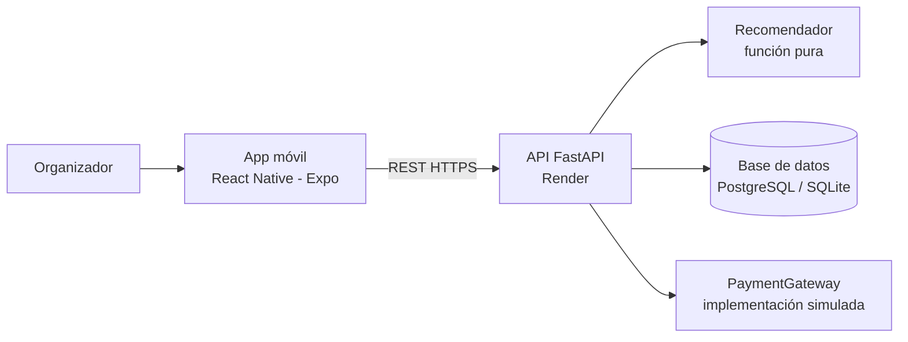
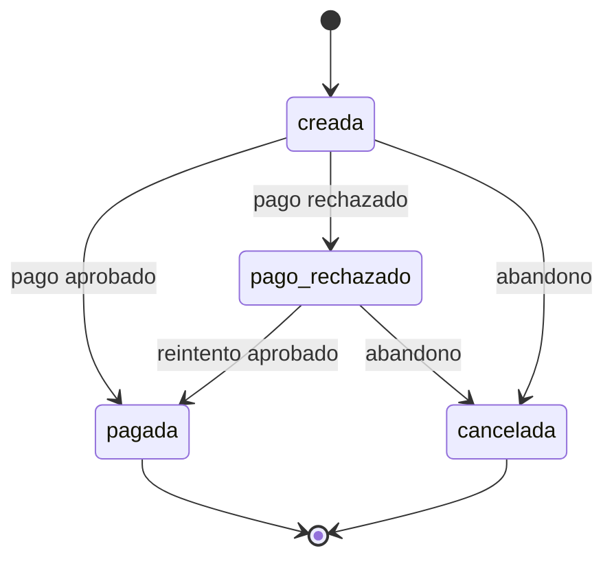
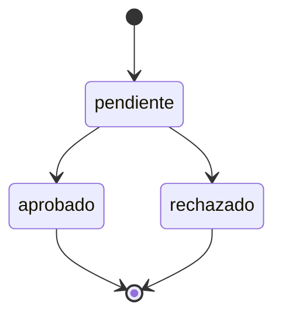

# Proyecto de MVP — EventU

**Versión:** 2.0 (marketplace, cambio CR-01; la 1.1 era del 5 de noviembre de 2026) · **Fecha:** 7 de noviembre de 2026 · **Estado:** Borrador para revisión del equipo
**Fuente primaria:** Entrega 1 — Proyecto EventU (Innovación y Emprendimiento Empresarial, Universidad del Valle)
**Otras fuentes:** prototipo de frontend de Juan Carlos (referencia de diseño; por decisión del equipo no se revisa en este documento)
**Convención:** «Propuesto» = valor sin fuente en la Entrega 1, a validar. «Supuesto» = decisión tomada para poder avanzar.

---

## 1. Identificación del proyecto

| Campo | Valor |
|---|---|
| Nombre | EventU |
| Concepto | Aplicación móvil (Android/iOS) que convierte un presupuesto en paquetes completos de servicios para eventos sociales en Cali |
| Curso / Docente | Innovación y Emprendimiento Empresarial · Prof. Víctor Bucheli |
| Institución | Universidad del Valle, Escuela de Ingeniería de Sistemas y Computación |
| Siglas | EU |
| Versión del MVP | 1.0 (sprint de 3 días) |

**Equipo y roles en el sprint** (ajustados respecto a la matriz de capacidades de la Entrega 1):

| Integrante | Rol en el MVP |
|---|---|
| David Enciso | Backend (FastAPI) y pruebas (QA) |
| Jean Paul Davalos | Frontend de la app móvil |
| Yenny Rivas | Producto, contenido y datos del catálogo, marca |
| Juan Manuel Perea | Por confirmar (ver P-02) |
| Juan Carlos Cruz | Ya entregó el prototipo de frontend; sin tareas en este sprint |

## 2. Antecedentes

Hoy los organizadores cotizan servicio por servicio por WhatsApp e Instagram, arman comparativos en Excel que terminan desajustados y navegan perfiles de proveedores sin reseñas. En la observación de campo, cinco usuarios abrían en promedio 14 pestañas y enviaban más de 20 mensajes para obtener precios (Entrega 1, §3.2.3). Los directorios web existentes son estáticos: listan contactos, pero no calculan qué alcanza con un presupuesto dado.

## 3. Problema

El organizador ocasional no sabe qué le alcanza con el dinero que tiene, pierde días reuniendo cotizaciones dispersas y teme incumplimientos de proveedores que no conoce. La dificultad central no es encontrar proveedores, sino integrar servicios y conocer el costo total antes de decidir (Entrega 1, §3.1.4).

## 4. Usuarios del sistema

| Actor | Descripción | Interacción en el MVP |
|---|---|---|
| Organizador (visitante) | Cliente principal: «organizador ocasional estresado», 22–45 años, estratos 3–5, 1 a 3 eventos al año | Usa todo el flujo, sin registro |
| Proveedor | Empresa o persona que ofrece servicios | Es un dato curado del catálogo; no accede al sistema |
| Administrador del catálogo | Equipo EventU | Carga y verifica datos fuera de la aplicación (semilla); sin panel en el MVP |
| Pasarela de pago simulada | Componente interno | Aprueba o rechaza pagos de prueba |

## 5. Visión y propuesta de valor

**Visión:** que cualquier persona pueda organizar su celebración en Cali desde su celular, sabiendo desde el inicio cuánto cuesta y qué incluye cada opción.

**Propuesta de valor (CR-01):** EventU se presenta como un marketplace de servicios para eventos, con la exploración, las fichas, las fotos, las calificaciones y el mapa propios de Booking, Trivago o TripAdvisor, y con un atajo único: a partir de un presupuesto, EventU propone tres paquetes integrales (Ahorro, Equilibrado, Premium) con desglose transparente por rubro y proveedores con estado de verificación, sin cobro al organizador (Entrega 1, §4.1 y lienzo).

## 6. Objetivos

**Objetivo general:** construir y desplegar en 3 días un MVP funcional que lleve al organizador desde su presupuesto hasta una reserva con pago simulado y confirmación.

| ID | Objetivo específico | Tarea | Métrica de éxito (Entrega 1, §3.8) |
|---|---|---|---|
| OE-1 | Recomendar paquetes que respeten el presupuesto | T1 | En los escenarios de prueba, ningún paquete supera el presupuesto ingresado; se muestra costo total y desglose por rubro |
| OE-2 | Cotizar sin conversaciones individuales | T2 | Un usuario compara al menos dos paquetes y consulta su desglose en ≤ 5 minutos (se registra el tiempo real) |
| OE-3 | Dar confianza sobre cada proveedor | T3 | Toda ficha «verificada» tiene datos y comprobaciones documentadas |
| OE-4 | Ofrecer modalidades comparables | T4 | Tres modalidades con costos y servicios; al cambiar de opción, el presupuesto restante se actualiza sin exceder el límite |
| OE-5 | Completar el flujo hasta la reserva | T1–T2 | Un usuario llega a la confirmación con número de reserva (Supuesto S-02) |

## 7. Alcance del MVP

| Dentro del alcance | Fuera del alcance |
|---|---|
| Marketplace móvil: inicio con buscador, categorías y destacados; resultados en lista y mapa con filtros y orden (Cali y área metropolitana) | Pasarela de pago real y cobros con dinero |
| Recomendador por presupuesto, tipo de evento e invitados | Abonos por fases y gestión automatizada de reservas |
| Cotización y presupuesto restante en tiempo real | RSVP e invitaciones digitales |
| Fichas de proveedor con galería, calificación, reseñas de ejemplo y estado de verificación | Panel y suscripciones para proveedores |
| «Mi evento» (carrito de servicios) y datos de contacto del cliente | Cuentas de usuario y autenticación del cliente; reseñas escritas por usuarios; disponibilidad por fecha |
| Reserva y **pago simulado** (sandbox) | Personalización estética (T5) como función propia |
| Confirmación con número de reserva | IA generativa |

## 8. Arquitectura conceptual

## 9. Stack tecnológico propuesto

| Elemento | Elección (Propuesto) | Justificación |
|---|---|---|
| App móvil | React Native + Expo + TypeScript | Reutiliza el conocimiento de JavaScript del equipo; un solo código para Android e iOS; se prueba en el celular con Expo Go. Confirmado por el equipo |
| Backend (definido) | FastAPI (Python) | API REST pequeña, validación integrada y buen soporte de pruebas |
| Base de datos | PostgreSQL (SQLite en local) | Modelo relacional simple: proveedores, servicios, reservas, pagos |
| Despliegue y distribución | Render (API); Expo Go o APK de prueba (app) | API en línea sin infraestructura propia; la app se instala en los dispositivos de la demo sin publicarla en tiendas |
| Calidad | Linter + tipos + tests con un único comando | Puerta de calidad antes de cada PR |

## 10. Roles del equipo en el sprint de 3 días

| Persona | Responsabilidades concretas |
|---|---|
| David | Esqueleto del API, modelo de datos, listado y ficha de proveedores, cotización, algoritmo recomendador y sus pruebas, endpoints de reserva y pago simulado; pruebas de punta a punta y casos del pago simulado (85 SP propuestos) |
| Jean Paul | Adaptar el prototipo a la app como marketplace: inicio, resultados, filtros, ficha con galería, «Mi evento», datos del cliente, pago y confirmación; mapa si hay tiempo; integración con el API (64 SP propuestos) |
| Yenny | Datos del catálogo (15–20 proveedores) con fotos, reseñas de ejemplo y coordenadas, textos y mensajes, guion de prueba con usuarios (11 SP propuestos) |
| Juan Manuel | Por confirmar (posible apoyo al frontend móvil; ver P-02) |
| Juan Carlos | Sin tareas: su prototipo se adopta como referencia de pantallas y navegación |

**Riesgos:** el frontend móvil depende de una sola persona (R-08), David concentra backend y pruebas (R-09) y el alcance completo de CR-01 supera la capacidad estimada (R-10). Con 160 SP frente a 108 de referencia, el equipo debe decidir el reparto con Juan Manuel (P-02) o un día de colchón.

## 11. Módulos del sistema

| Módulo | Función |
|---|---|
| Catálogo y exploración (marketplace) | Inicio, resultados en lista y mapa, filtros y orden, ficha con fotos y calificación |
| Recomendador | Atajo que genera los 3 paquetes a partir de presupuesto, tipo de evento e invitados y los carga en «Mi evento» |
| Proveedores | Ficha con contacto, alcance del servicio y estado de verificación |
| Reserva | «Mi evento», datos del cliente y registro de la reserva |
| Pago simulado | Aprobación o rechazo con tarjetas de prueba |
| Confirmación | Resumen y número de reserva |

## 12. Reglas de negocio

| ID | Regla |
|---|---|
| RN-01 | El costo total de cualquier paquete sugerido nunca supera el presupuesto ingresado |
| RN-02 | Existen tres modalidades: **Ahorro** (prioriza menor costo), **Equilibrado** (relación costo-calidad) y **Premium** (prioriza mayor nivel de servicio dentro del presupuesto). El reparto del presupuesto por rubro en cada modalidad es Propuesto y se fija en el SRS |
| RN-03 | Todo paquete incluye espacio, alimentación y decoración; el entretenimiento es opcional (Propuesto, S-01) |
| RN-04 | El total es la suma de los ítems del paquete; el dinero se maneja en pesos COP enteros |
| RN-05 | Presupuesto restante = presupuesto ingresado − total del paquete vigente; se recalcula al modificar servicios |
| RN-06 | Si el presupuesto no alcanza ni para el paquete Ahorro, el sistema lo informa y no muestra paquetes que lo excedan |
| RN-07 | «Proveedor verificado» significa que su ficha tiene datos y comprobaciones documentadas. No garantiza el cumplimiento del servicio |
| RN-08 | La reserva guarda una copia de los servicios y precios vigentes al momento de reservar |
| RN-09 | El pago es simulado: no mueve dinero ni almacena datos de tarjeta; solo registra aprobado o rechazado |
| RN-10 | Los precios y proveedores del catálogo inicial son datos de ejemplo, por validar con proveedores reales |

## 13. Estados de reserva y pago

## 14. Caso de uso principal

**Actor:** organizador. **Resultado:** reserva confirmada con pago simulado.

1. **Inicio:** busca por tipo de evento, fecha e invitados, toca una categoría o un destacado, o usa el atajo «Arma mi evento por presupuesto» (que entrega tres paquetes y carga el elegido).
2. **Resultados:** ve los proveedores en tarjetas o en el mapa, con foto, calificación, verificación y precio «desde»; filtra y ordena.
3. **Ficha de proveedor:** revisa galería, reseñas de ejemplo, contacto, alcance y verificación, y agrega servicios a «Mi evento».
4. **Mi evento:** cambia o quita servicios; el total (y el restante, si indicó presupuesto) se actualizan.
5. **Datos del cliente:** ingresa nombre, correo, teléfono y fecha del evento.
6. **Pago simulado:** revisa el resumen y paga con una tarjeta de prueba (aprobada o rechazada).
7. **Confirmación:** recibe el número de reserva y el resumen; puede consultarla después en la pestaña «Reservas».

**Flujos alternos:** presupuesto insuficiente (RN-06); falta un rubro obligatorio en «Mi evento» (RN-23); pago rechazado con reintento; datos inválidos; error de red.

## 15. Flujo de trabajo con agentes de IA

- Un archivo de instrucciones del repositorio (`CLAUDE.md`) define stack, estructura y reglas.
- Para cada historia, el agente propone un plan y el equipo lo aprueba antes de codificar.
- Una rama y un PR pequeño (≤ 300 líneas, orientativo) por historia.
- Ningún PR se fusiona sin lint, tipos y tests en verde.
- Cada prompt, respuesta y corrección se registra en una bitácora; los fallos de la IA se anotan como «fixes».

## 16. Calidad y métricas del MVP

| Métrica | Criterio |
|---|---|
| Respeto del presupuesto | 0 paquetes sobre el presupuesto en todos los escenarios de prueba, incluida una prueba de propiedad con entradas aleatorias |
| Tiempo de comparación | ≤ 5 min para comparar dos paquetes y ver el desglose (se mide con usuarios) |
| Exploración | Una persona llega de la búsqueda a la ficha de un proveedor y a «Mi evento» en ≤ 3 pasos (se mide con usuarios, Propuesto) |
| Modalidades | Las 3 visibles con costos y servicios incluidos |
| Presupuesto restante | Se actualiza en cada cambio, sin superar el límite |
| Verificación | 100 % de fichas «verificadas» con datos documentados |
| Flujo completo | Una persona completa el recorrido hasta la confirmación |

## 17. Riesgos y mitigaciones

| ID | Riesgo | Mitigación |
|---|---|---|
| R-01 | Datos del catálogo insuficientes o poco creíbles | Semilla de 15–20 proveedores definida el día 1 y marcada como ejemplo |
| R-02 | 3 días no alcanzan para todo | Recorte previsto: pulido de UI y fichas antes que el flujo hasta el pago |
| R-03 | Crecimiento del alcance | Tabla dentro/fuera de alcance (§7) como referencia única |
| R-04 | El agente genera código incorrecto o rompe lo existente | Plan previo, PRs pequeños y puerta de calidad; registro de fixes |
| R-05 | Fallos de despliegue del API o de distribución de la app el último día | API desplegado y app instalada en un dispositivo el día 1 |
| R-06 | Los evaluadores esperan un pago real | Declarar el pago como simulado en la demo y en la documentación |
| R-07 | Cifras o precios tomados como definitivos | Etiquetar los datos de ejemplo como «por validar» |
| R-08 | El frontend móvil depende de una sola persona (Jean Paul) | Partir del prototipo de Juan Carlos, priorizar las pantallas del flujo principal y definir el apoyo de Juan Manuel (P-02) |
| R-10 | El alcance del CR-01 suma 160 SP frente a una capacidad de referencia de 108 SP | Priorizar los Must (111 SP) y recortar Could y Should en el orden indicado en el backlog; evaluar un día de colchón o apoyo de Juan Manuel (P-02) |
| R-11 | Fotos de un servicio externo y reseñas ficticias | Recuadro neutro si falla la foto; rotular las reseñas como ejemplo; fotos con licencia después |
| R-12 | El mapa depende de una librería nativa y de una clave de Google Maps en Android fuera de Expo Go | Es Could; probar en Expo Go y omitir si no cabe |
| R-09 | David concentra backend y pruebas | Automatizar las pruebas del recomendador, priorizar los requisitos Must y hacer revisión cruzada de PRs con Jean Paul |

## 18. Restricciones

- Plazo: 3 días de desarrollo con agentes de IA.
- Equipo de 5 personas; en el sprint desarrollan 2 (David en backend y pruebas, Jean Paul en la app móvil), Yenny aporta datos y contenido y Juan Carlos ya entregó el prototipo.
- Sin presupuesto para servicios de terceros de pago; uso de planes gratuitos.
- La app se distribuye como versión de prueba (Expo Go o APK); no se publica en tiendas.
- Alcance limitado al mercado de Cali y su área metropolitana.
- El catálogo es curado y pequeño; no hay integración con sistemas de proveedores.

## 19. Planeación

| Hito | Entregables | Criterio de «hecho» |
|---|---|---|
| **Día 1** | Repositorios con `CLAUDE.md`; API desplegado en Render; app móvil (adaptada del prototipo) corriendo en un dispositivo y consumiendo el API; semilla del catálogo con fotos, reseñas y coordenadas; Inicio con navegación por pestañas; atajo por presupuesto y algoritmo v1 con pruebas | La app en el celular obtiene datos del API desplegado; el algoritmo pasa la prueba de «nunca supera el presupuesto» |
| **Día 2** | Resultados con tarjetas, filtros y orden, ficha con galería y reseñas, «Mi evento» con recálculo y cotización; reserva desde «Mi evento» lista para el Día 3 | Un usuario llega hasta la creación de la reserva en la app contra el API desplegado |
| **Día 3** | Reserva, pago simulado, confirmación, mapa (si hay tiempo), pruebas de punta a punta, ajustes de UX, prueba con usuarios y bitácora completa | El flujo completo funciona en la app contra el API desplegado y `make check` está en verde |

## 20. Supuestos y decisiones pendientes

| ID | Tipo | Detalle |
|---|---|---|
| S-01 | Supuesto | La Entrega 1 define el paquete con lugar, alimentación y decoración (T1); el lienzo menciona DJs como proveedores. Se trata el entretenimiento como cuarto rubro opcional |
| S-02 | Supuesto | El MVP incluye reserva y pago **simulado**. La Entrega 1 (§4.3.2) clasifica la pasarela de pago como fase futura; este ajuste de alcance debe informarse al docente |
| S-03 | Supuesto | El cliente no tiene cuenta: deja datos de contacto en cada reserva |
| S-04 | Supuesto | El prototipo de Juan Carlos es la referencia de pantallas y navegación; Juan Carlos no tiene tareas en este sprint |
| S-05 | Supuesto (CR-01) | Reseñas y calificaciones de ejemplo y de solo lectura |
| S-06 | Supuesto (CR-01) | Fotos de ejemplo de un banco de imágenes, a sustituir por fotos con licencia |
| S-07 | Supuesto (CR-01) | Coordenadas aproximadas por barrio |
| S-08 | Supuesto (CR-01) | El marketplace es la entrada principal y el recomendador por presupuesto es un atajo; el equipo aceptó el alcance completo aunque exceda la capacidad estimada |
| P-01 | Pendiente | Fecha de entrega del MVP |
| P-02 | Pendiente | Rol de Juan Manuel Perea (¿apoya el frontend móvil?) y quién actúa como líder gestor (la Entrega 1 menciona «un líder gestor» sin nombrarlo) |
| P-03 | Pendiente | ¿Habrá administración del catálogo desde la aplicación o solo por semilla? |
| P-04 | Resuelto | Framework móvil confirmado por el equipo: React Native con Expo |
| P-05 | Pendiente | Porcentajes de reparto del presupuesto por rubro y modalidad (se fijan en el SRS) |
| P-06 | Pendiente | Fuente de precios y proveedores reales para sustituir los datos de ejemplo |
| P-07 | Resuelto | David asume las pruebas (QA) además del backend (ver R-09) |
| P-08 | Cerrado | El equipo decidió no conciliar el documento con el prototipo; Juan Carlos no tiene tareas y el frontend adapta el prototipo según los requisitos |

---

### Autoverificación

- Cada objetivo específico se liga a una tarea: OE-1 → T1, OE-2 → T2, OE-3 → T3, OE-4 → T4, OE-5 → T1–T2 (con S-02). ✔
- Alcance dentro/fuera coherente con la Entrega 1, salvo el ajuste declarado: pago simulado (S-02). ✔
- Cifras: solo las de la Entrega 1 (14 pestañas, más de 20 mensajes, 22–45 años, estratos 3–5, $3–15 millones COP, 1–3 eventos al año), con sección citada. ✔
- Secciones 1 a 20 presentes. ✔
- Versión 2.0 incorpora CR-01: alcance, módulos, caso de uso, roles, riesgos R-10 a R-12, planeación y supuestos S-05 a S-08. ✔
- Diferencias con el prompt: el rubro de entretenimiento no está en T1 de la Entrega 1 (S-01); el rol de Juan Manuel Perea no figura en la matriz de capacidades extraída (P-02); el prototipo de frontend es solo referencia de diseño y no se concilia (P-08 cerrado); framework móvil confirmado (P-04); David asume las pruebas (P-07) y queda el riesgo R-09.
