# Documento de Arquitectura de Software (SAD) — EventU (EU)

| Campo | Valor |
|---|---|
| Proyecto | EventU: marketplace móvil de servicios para eventos sociales en Cali, con recomendador de paquetes por presupuesto como atajo |
| Versión | 2.0 — incorpora el cambio CR-01 (marketplace); la versión 1.0 era del 5 de noviembre de 2026 |
| Norma de referencia | ISO/IEC/IEEE 42010:2011 (vistas, decisiones y atributos de calidad) |
| Fuentes | SRS v2.0, Product Backlog v2 (16 HU) y Backlog Extendido, Proyecto de MVP y solicitud de cambio CR-01. El prototipo de Juan Carlos es solo referencia de diseño |
| Fecha | 7 de noviembre de 2026 |
| Estado | Borrador para validación del equipo. Todo valor sin fuente está marcado «Propuesto» |

---

## 1. Introducción

### 1.1 Propósito y alcance
Este documento fija la arquitectura más simple que cumple el SRS en un sprint de 3 días, de modo que un agente de IA pueda implementar cada historia con el cambio mínimo y sin inventar estructura. Cubre la app móvil, el API REST y la base de datos, hasta el pago simulado y la confirmación. Queda fuera: autenticación de usuarios finales, RSVP, invitaciones, panel de proveedores y pasarela de pago real.

**Cambio CR-01 (resumen).** La app pasa de un flujo lineal por presupuesto a un marketplace: Inicio → Resultados (lista o mapa) → Ficha → «Mi evento» → Datos → Pago → Confirmación. El recomendador conserva su diseño (§6) y su rol es llenar «Mi evento» como atajo. Reservas y pagos no cambian de fondo: una reserva sigue siendo una lista de servicios con un total que calcula el servidor.

### 1.2 Vista global

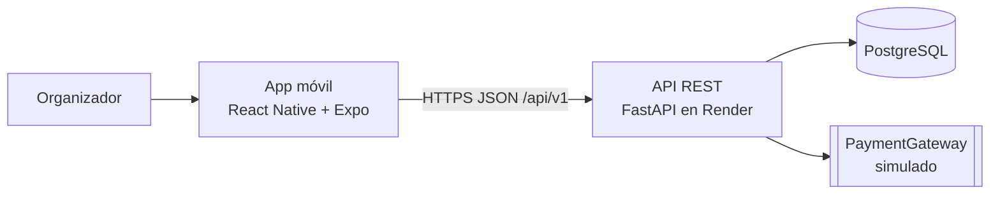

### 1.3 Stack y justificación

| Capa | Tecnología | Justificación |
|---|---|---|
| App móvil | React Native + Expo + TypeScript | Una sola base de código para Android e iOS (RNF-POR-02, RNF-COM-01); parte del prototipo; confirmado por el equipo |
| API | FastAPI (Python 3.12) | Definido por el equipo; genera OpenAPI sin trabajo extra (RNF-MAN-03) |
| Acceso a datos | SQLAlchemy 2 y Alembic | Un solo modelo para SQLite y PostgreSQL; migraciones versionadas |
| Base de datos | SQLite en desarrollo y pruebas; PostgreSQL en el despliegue | Ver ADR-06 |
| Calidad | ruff, mypy, pytest (API); ESLint, tsc y Jest (app) | Puerta de calidad de RNF-MAN-02 |
| Despliegue | Render (API) y Expo Go o APK de prueba (app) | Ver ADR-08 |

---

## 2. Macro arquitectura y patrones

### 2.1 Decisiones de arquitectura (ADR)

**ADR-01 · Monolito de dos capas (app y API)** — Propuesto
- Contexto: 3 días, 2 desarrolladores, sin necesidad de escala (RNF-EFI-01, RNF-MAN-02).
- Decisión: una app móvil y un único servicio FastAPI con una base de datos.
- Alternativas descartadas: microservicios (coste de despliegue y coordinación sin beneficio); backend como servicio gestionado (el equipo ya definió FastAPI).
- Consecuencias: despliegue y depuración simples; el límite entre módulos se mantiene por convención (ADR-02).

**ADR-02 · Módulos por dominio funcional** — Propuesto
- Contexto: el SRS agrupa los requisitos en catálogo, recomendador, proveedores, reservas y pagos.
- Decisión: el backend se organiza en los paquetes `catalogo`, `recomendador`, `proveedores`, `reservas` y `pagos`; cada uno contiene sus routers, servicios y repositorios. Con CR-01, `proveedores` también atiende el listado, el inicio y la ficha ampliada, y `recomendador` aloja la cotización de «Mi evento».
- Alternativas descartadas: organizar por capa técnica en el nivel superior (mezcla historias distintas en los mismos archivos y aumenta los conflictos entre David y los agentes).
- Consecuencias: cada HU toca un solo módulo; `recomendador` no depende de ningún otro módulo.

**ADR-03 · Dominio puro separado de la infraestructura** — Propuesto
- Contexto: el recomendador debe ser una función pura con pruebas (RNF-MAN-01, RNF-ADF-01, RN-01).
- Decisión: `recomendar(...)` y las reglas de ajuste viven en `domain/` sin importar FastAPI, SQLAlchemy ni nada de red; reciben el catálogo como datos.
- Alternativas descartadas: calcular en consultas SQL (difícil de probar y de razonar sobre la invariante).
- Consecuencias: pruebas rápidas sin base de datos; la prueba de propiedad es trivial.

**ADR-04 · Dinero como entero en pesos COP** — Propuesto
- Contexto: RN-04 y RN-15 exigen COP enteros y sumas exactas.
- Decisión: todo importe se guarda y transmite como entero (`*_cop`); los precios por invitado se multiplican y se redondean a entero antes de sumar.
- Alternativas descartadas: `float` (errores de redondeo); `Decimal` (innecesario: el COP no usa decimales en este contexto).
- Consecuencias: la app solo formatea para mostrar (separador de miles).

**ADR-10 · El marketplace es la entrada y «Mi evento» es el único camino a la reserva** — Propuesto (CR-01)
- Contexto: se pidió una experiencia tipo Booking, Trivago y TripAdvisor sin perder el recomendador ni el flujo hasta el pago.
- Decisión: toda selección, venga de la ficha de un proveedor o de un paquete recomendado, termina en un carrito de servicios llamado «Mi evento». La reserva se crea siempre desde `service_ids`; el origen (`modality`) es la modalidad del paquete o `personalizado` (RN-21).
- Alternativas descartadas: dos flujos de reserva (uno por paquete y otro por servicios), que duplicarían pantallas, pruebas y reglas.
- Consecuencias: `/recommendations/adjust` se reemplaza por `POST /quotes`, que cotiza cualquier conjunto de servicios; el presupuesto es opcional (RN-22).

**ADR-11 · Listado, precio «desde», orden y paginación en la capa de servicio** — Propuesto (CR-01)
- Contexto: el precio de un servicio por invitado depende del número de invitados (RN-15), y el orden depende de ese precio y de la calificación (RN-25, RN-26).
- Decisión: el repositorio devuelve los proveedores y sus servicios elegibles con una consulta simple (BD §11.6); `proveedores/service.py` calcula el precio «desde», aplica filtros de precio y orden, y pagina en memoria. La calificación sale de la vista `v_providers`.
- Alternativas descartadas: calcular todo en SQL (consulta difícil de probar y distinta entre SQLite y PostgreSQL); calcular en la app (violaría ADR-09 y duplicaría reglas).
- Consecuencias: con unas decenas de proveedores el costo es insignificante; si el catálogo crece, se mueve a SQL con índices.

**ADR-12 · Fotos por URL externa y reseñas de solo lectura** — Propuesto (CR-01)
- Contexto: la ficha necesita galería y calificación (RF-EXP-05, RF-EXP-06) sin subir archivos ni crear cuentas.
- Decisión: `provider_images.url` apunta a un banco de imágenes (HTTPS) y las reseñas son datos de ejemplo cargados por la semilla; no existen endpoints de escritura. La app muestra un recuadro neutro si una foto no carga.
- Alternativas descartadas: almacenar archivos en el servidor o en un servicio de objetos (cuentas, costos y seguridad fuera del alcance); permitir reseñas de usuarios (requiere identidad y moderación).
- Consecuencias: depende de un servicio externo en la demo (R-11); sustituir por fotos con licencia es un cambio de datos, no de código.

**ADR-13 · Mapa con `react-native-maps` y filtro por zona** — Propuesto (CR-01, Could)
- Contexto: RF-EXP-09 pide ver los resultados en un mapa.
- Decisión: `react-native-maps` instalado con `npx expo install`; `GET /providers` acepta `bbox` (`lat_min,lon_min,lat_max,lon_max`) y las coordenadas son aproximadas (RN-28).
- Alternativas descartadas: un mapa web incrustado (rendimiento y experiencia pobres); calcular distancia al usuario (requiere permisos y no se pidió).
- Consecuencias: en Android fuera de Expo Go se requiere una clave de Google Maps (R-12); si no cabe en el sprint, se omite sin afectar el flujo.

**ADR-05 · Puerto `PaymentGateway` con implementación simulada** — Propuesto
- Contexto: RN-09 y RN-17: pago simulado sin datos de tarjeta.
- Decisión: interfaz `PaymentGateway.charge(reservation_code, amount_cop, card) -> PaymentResult` en el dominio de `pagos`; la implementación `SimulatedGateway` aprueba la tarjeta de prueba aprobada y rechaza todo lo demás.
- Alternativas descartadas: llamar a una pasarela de sandbox real (cuentas y credenciales fuera del alcance de 3 días).
- Consecuencias: una pasarela real sería una nueva implementación sin tocar el dominio ni los endpoints. El equipo confirmó que el pago es simulado en este sprint y que la meta final es un pago real y funcional; por eso el puerto es obligatorio. Para pasar a pago real habrá que sustituir `SimulatedGateway`, tokenizar la tarjeta en el cliente para que el número no llegue al servidor (RA-09), guardar solo la referencia del proveedor de pagos y confirmar el resultado con un webhook. Esos cambios quedan fuera de este sprint.

**ADR-06 · SQLite en desarrollo y PostgreSQL desplegado** — Propuesto
- Contexto: el equipo tiene PostgreSQL como opción y SQLite como alternativa liviana.
- Decisión: SQLite para desarrollo y pruebas; PostgreSQL gestionado para el despliegue, con la cadena de conexión en `DATABASE_URL`. Un único conjunto de modelos SQLAlchemy y migraciones Alembic sirve a ambos.
- Alternativas descartadas: solo SQLite en producción (el disco de Render gratuito no es persistente); solo PostgreSQL (obliga a levantar un servidor local para cada prueba).
- Consecuencias: las pruebas de integración corren en SQLite y hay que probar también el despliegue en PostgreSQL una vez antes de la demo. Debe verificarse el plan gratuito vigente y su vigencia, porque algunos planes gratuitos de base de datos caducan.

**ADR-07 · React Native + Expo y adopción del prototipo de Juan Carlos** — Propuesto (framework confirmado por el equipo)
- Contexto: app móvil para Android e iOS; Jean Paul es el único desarrollador móvil; Juan Carlos ya entregó un prototipo.
- Decisión: React Native con Expo y TypeScript; el prototipo se usa como referencia de pantallas y se adapta, no se rediseña. Navegación con React Navigation (pestañas inferiores Inicio, Resultados, Mi evento y Reservas, más una pila para el detalle); estado del flujo con un contexto de React; cliente del API propio sobre `fetch`.
- Alternativas descartadas: Flutter o desarrollo nativo (cero experiencia declarada del equipo); una librería de estado global (el flujo es lineal y el estado cabe en un contexto).
- Consecuencias: el prototipo no se reconcilia con el SRS en este documento; si difiere, el SRS manda y la diferencia se anota en el PR.

**ADR-08 · Despliegue del API y distribución de la app** — Propuesto
- Contexto: RNF-SEG-01 (HTTPS), RNF-POR-01 (URL por variable), RNF-FIA-02 (arranque en frío).
- Decisión: el API se despliega en Render desde la rama principal (HTTPS incluido); la app se distribuye con Expo Go para las pruebas del equipo y, si hay tiempo, un APK de prueba con EAS Build.
- Alternativas descartadas: tienda de aplicaciones (trámites incompatibles con 3 días); servidor propio (mantenimiento).
- Consecuencias: el plan gratuito duerme el servicio, por eso la app muestra el estado de carga hasta 60 s.

**ADR-09 · El servidor es la fuente de verdad del dinero** — Propuesto
- Contexto: RN-01, RN-08 y RNF-SEG-03.
- Decisión: la app recalcula localmente el total al ajustar un paquete (respuesta inmediata, RNF-EFI-02) y la confirmación definitiva la hace el servidor: `POST /quotes` (antes `/recommendations/adjust`) valida el ajuste y `POST /reservations` recalcula el total desde el catálogo vigente. El cliente envía identificadores de servicio, no precios.
- Alternativas descartadas: confiar en los importes enviados por la app (violaría RNF-SEG-03).
- Consecuencias: el catálogo vigente decide; si un precio cambió entre la recomendación y la reserva, la reserva se rechaza con `TOTAL_MISMATCH`.

### 2.2 Atributos de calidad y patrones

| RNF | Cómo lo cumple la arquitectura |
|---|---|
| RNF-ADF-01 | Dominio puro (ADR-03) y prueba de propiedad; el total siempre es la suma de ítems (ADR-04) |
| RNF-EFI-01 | Recomendación sin acceso a servicios externos: una consulta del catálogo y un cálculo O(R·S log S); respuestas sin campos innecesarios |
| RNF-EFI-02 | Recálculo local en la app (ADR-09) |
| RNF-COM-01, RNF-POR-02 | Expo con una sola base de código; versiones objetivo Android 10+ e iOS 15+ |
| RNF-COM-02 | Todas las rutas bajo `/api/v1` |
| RNF-USA-01 a 04 | Componentes de pantalla del prototipo con áreas táctiles de 44 pt, fuente del sistema y mensajes por campo; ver §8 |
| RNF-FIA-01, RNF-FIA-02 | Cliente del API con tiempo de espera de 60 s, estado de carga, error con reintento y estado del flujo conservado (§7.3) |
| RNF-SEG-01 a 05 | Vista de seguridad (§3) |
| RNF-MAN-01 | Dominio puro con cobertura mínima del 80 % |
| RNF-MAN-02 | `make check` y CI (§9 y §10) |
| RNF-MAN-03 | OpenAPI generado por FastAPI en `/docs` |
| RNF-POR-01 | `EXPO_PUBLIC_API_BASE_URL` en la app y `DATABASE_URL` en el API |

Patrones usados: puertos y adaptadores ligeros (solo `PaymentGateway` y los repositorios), repositorio por módulo y DTOs (esquemas pydantic) con validación en la frontera del API.

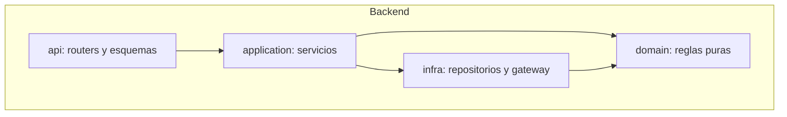

---

## 3. Vista de seguridad

| Control | Descripción | RNF |
|---|---|---|
| Validación en servidor | Todo cuerpo y parámetro se valida con esquemas pydantic; el cliente no es de confianza; los importes y totales se recalculan en el servidor | RNF-SEG-03 |
| HTTPS | Render sirve el API solo por HTTPS; la app rechaza URLs base que no empiecen por `https://` fuera del modo desarrollo | RNF-SEG-01 |
| Límites de entrada | Rangos de RN-19 (Propuesto), longitudes máximas de texto (nombre 100, correo 254, Propuesto) y tamaño máximo del cuerpo | RNF-SEG-03 |
| Limitación de tasa | Límite simple en memoria por IP, 60 peticiones por minuto (Propuesto); responde 429 `RATE_LIMITED` | RNF-SEG-03 |
| Tarjetas | `POST /payments` recibe los datos de la tarjeta de prueba solo para decidir aprobado o rechazado; no se guardan, no se registran y los registros de acceso no incluyen cuerpos de petición | RNF-SEG-02, RN-09 |
| Secretos | Variables de entorno en Render y archivo `.env` local ignorado por git; `.env.example` sin valores | RNF-SEG-04 |
| Datos personales | Solo nombre, correo y teléfono en la reserva; aviso de tratamiento visible en «Datos del cliente» (texto pendiente, PB-09) | RNF-SEG-05 |
| Registros | Los registros de error no contienen nombre, correo, teléfono ni datos de tarjeta | RNF-SEG-02, RNF-SEG-05 |

**OWASP API Security Top 10 (2023), resumen**

| Riesgo | Aplicación en EventU | Control |
|---|---|---|
| API1 Autorización a nivel de objeto | Las reservas se consultan por código no secuencial | Código de 6 caracteres aleatorios (Propuesto); aceptado el riesgo de adivinarlo en el MVP |
| API2 Autenticación rota | No hay autenticación de usuarios finales | Fuera de alcance; no hay endpoints de administración |
| API3 Autorización de propiedad | El cliente no puede fijar precios ni estados | ADR-09; el estado lo fija solo el servidor |
| API4 Consumo de recursos | Abuso de recomendaciones | Limitación de tasa y rangos de entrada |
| API5 Autorización a nivel de función | No hay funciones privilegiadas | El catálogo es de solo lectura vía API |
| API6 Flujos de negocio sensibles | Doble pago de una reserva | Un pago aprobado sobre una reserva pagada se ignora (RF-PAG-07) |
| API7 SSRF | El API no hace peticiones salientes | No aplica |
| API8 Configuración incorrecta | Documentación y errores | Errores sin trazas; `/docs` abierto solo fuera de producción (Propuesto) |
| API9 Inventario inadecuado | Versiones y rutas | Un único prefijo `/api/v1`; OpenAPI vigente |
| API10 Consumo inseguro de APIs | No se consumen APIs externas | No aplica |

---

## 4. Vista física y de infraestructura

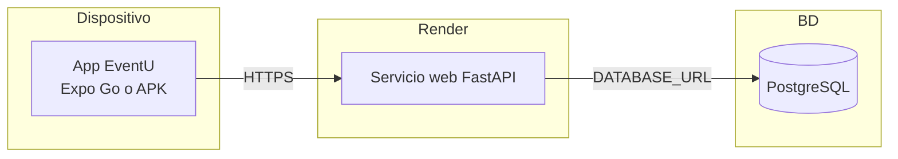

- **URL base del API.** La app la lee de `EXPO_PUBLIC_API_BASE_URL`. Desde un dispositivo físico no sirve `localhost`: se usa la URL desplegada o la IP de la red local del computador (por ejemplo `http://192.168.x.x:8000`, solo en desarrollo).
- **Variables de entorno del API (sin valores):** `DATABASE_URL`, `ENVIRONMENT` (`development` o `production`), `LOG_LEVEL`, `RATE_LIMIT_PER_MINUTE`, `SEED_ON_STARTUP`.
- **Variables de la app:** `EXPO_PUBLIC_API_BASE_URL`.
- **Chequeo de salud.** `GET /api/v1/health` lo usa Render y sirve para «despertar» el servicio antes de la demo.

---

## 5. Vista funcional (procesos clave)

### 5.1 Recomendación de paquetes (HU_EU_01_01, 01_02, 01_03)

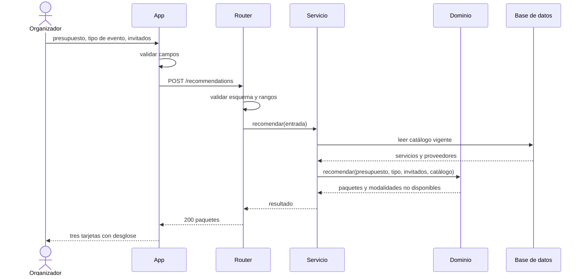

### 5.2 Ajuste de «Mi evento» y cotización (HU_EU_02_06, 02_13)

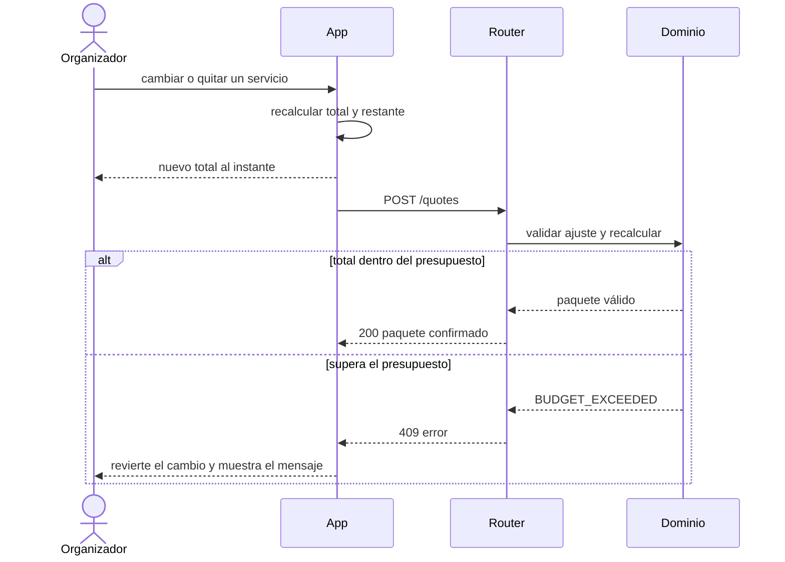

### 5.3 Creación de reserva (HU_EU_03_09)

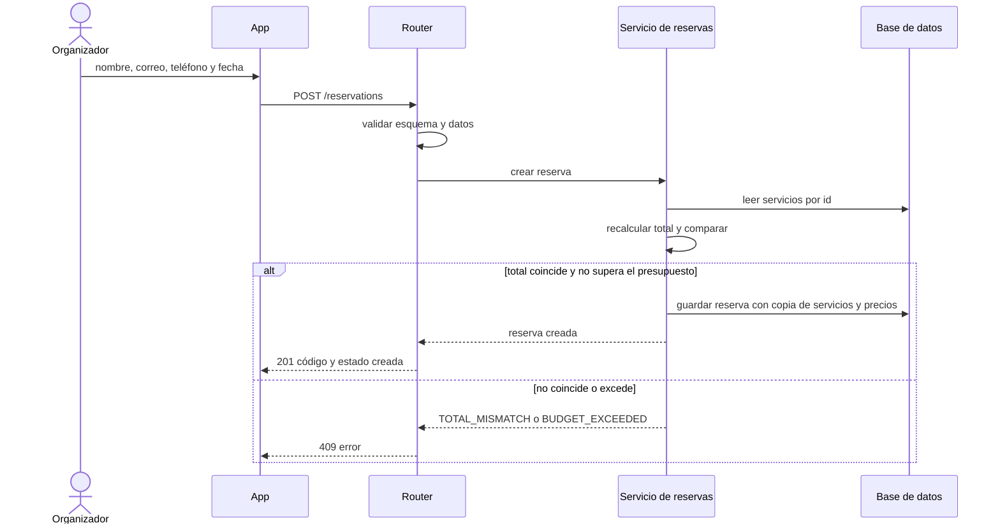

### 5.4 Pago simulado y estados (HU_EU_03_10)

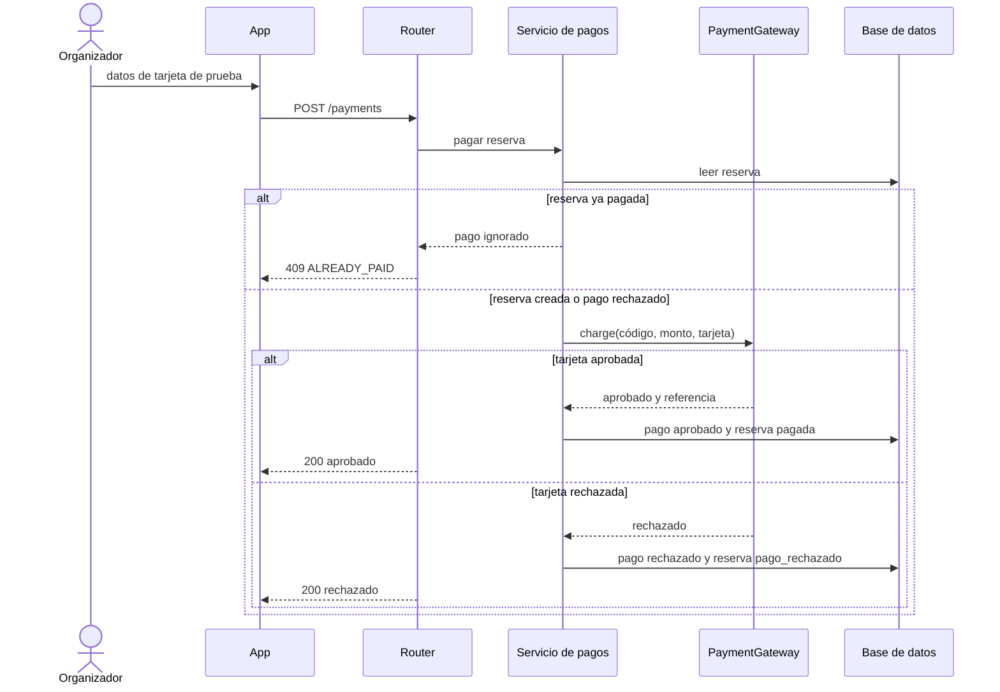

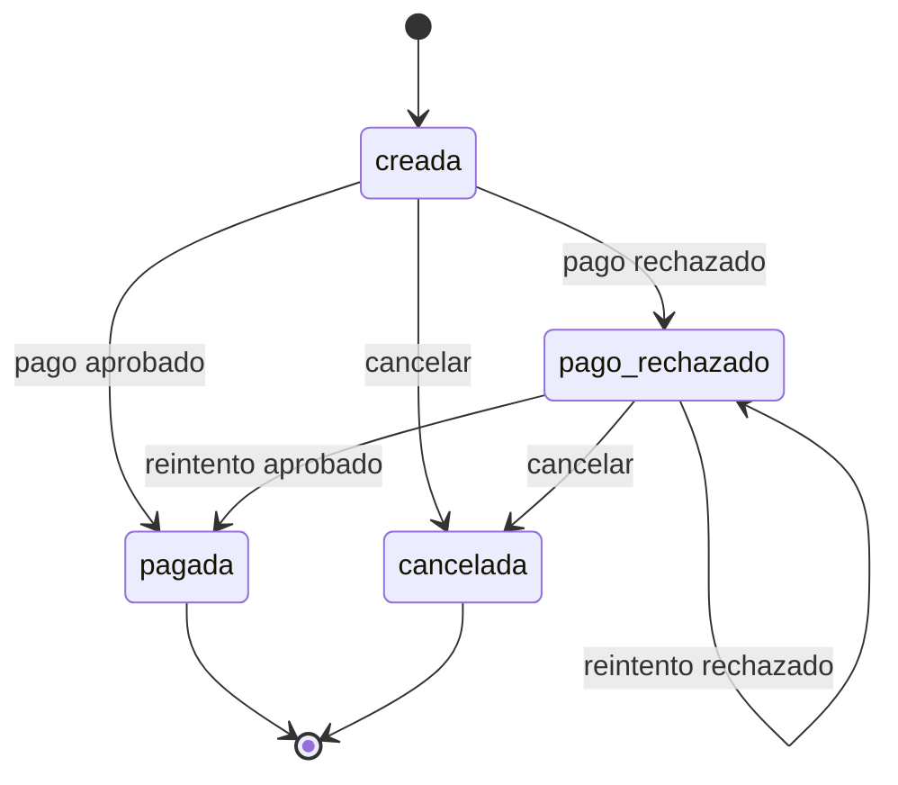

### 5.5 Consulta de confirmación (HU_EU_03_11)

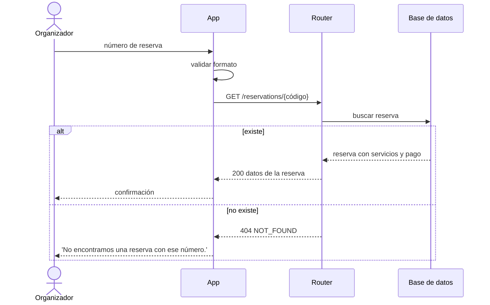

---

### 5.6 Exploración del marketplace (HU_EU_01_12, 02_05, 02_15, 02_16, 03_14)

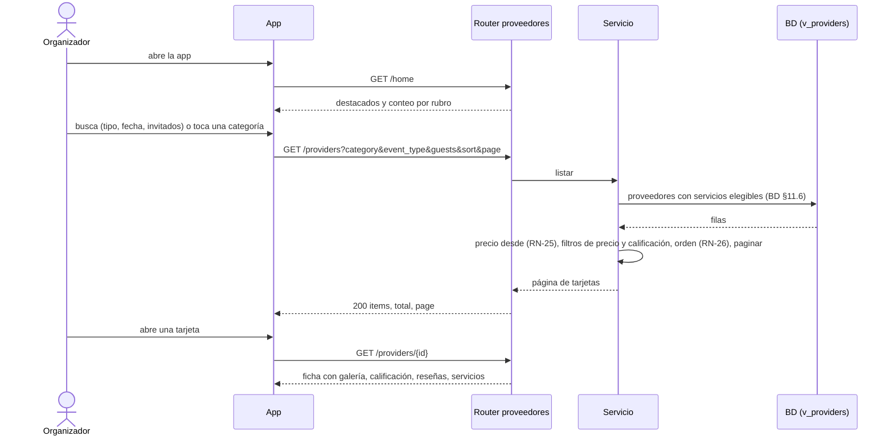

El modo mapa reutiliza `GET /providers` con `bbox`. Las fotos las descarga la app directamente de la URL guardada; si falla, muestra un recuadro neutro.

### 5.7 «Mi evento» y cotización (HU_EU_02_13, 02_06)

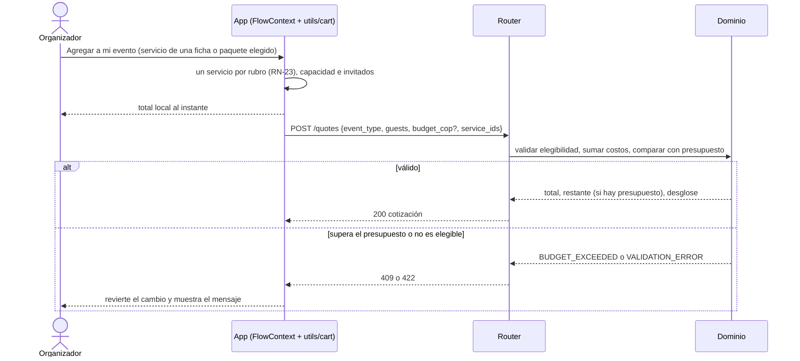

`POST /reservations` repite la misma validación, exige espacio, alimentación y decoración, y compara `expected_total_cop` con el total calculado (ADR-09).

## 6. Especificación del algoritmo recomendador

### 6.1 Entradas y validaciones
- Entradas: `presupuesto` (entero COP), `tipo_evento` (`cumpleanos`, `boda` o `xv`), `invitados` (entero) y `catalogo` (lista de servicios con rubro, precio, modelo de precio, capacidad, tipos de evento admitidos, nivel, id y proveedor).
- Validaciones de borde (RN-19, Propuesto): presupuesto de 1.000.000 a 50.000.000; invitados de 1 a 500. La función asume entradas ya validadas y no accede a red ni a base de datos.

### 6.2 Parámetros editables (Propuesto)

| Parámetro | Ahorro | Equilibrado | Premium |
|---|---|---|---|
| Porcentaje máximo del presupuesto (RN-11) | 70 % | 85 % | 100 % |
| Criterio de selección por rubro (RN-13) | Menor precio elegible | Nivel intermedio dentro del tope | Mayor precio dentro del tope |
| ¿Incluye entretenimiento? | No | Si hay un servicio elegible dentro de su tope | Si hay un servicio elegible dentro de su tope |

| Rubro | Reparto del monto objetivo (RN-12) |
|---|---|
| Espacio | 40 % |
| Alimentación | 35 % |
| Decoración | 15 % |
| Entretenimiento | 10 % (si no se incluye, se reparte en proporción entre los demás rubros) |

### 6.3 Costo de un servicio
`costo(s) = s.precio` si el modelo es fijo; `costo(s) = round(s.precio * invitados)` si es por invitado (RN-15). El redondeo es al entero más cercano.

### 6.4 Pseudocódigo

```text
función recomendar(presupuesto, tipo, invitados, catalogo):
    elegibles = [s en catalogo si tipo en s.tipos y s.capacidad >= invitados]   # RN-14
    para cada servicio en elegibles: servicio.costo = costo(servicio)
    resultado = []; no_disponibles = []
    para cada modalidad en [Ahorro, Equilibrado, Premium]:
        objetivo = floor(presupuesto * PCT[modalidad])
        rubros = [espacio, alimentacion, decoracion] (+ entretenimiento si la modalidad lo permite)
        topes = repartir(objetivo, rubros, REPARTO)        # enteros; la suma es <= objetivo
        elegidos = []
        para cada rubro en rubros:
            candidatos = ordenar([s en elegibles si s.rubro == rubro], por (costo, id))
            dentro = [s en candidatos si s.costo <= topes[rubro]]
            si dentro no está vacío:
                s = seleccionar(modalidad, dentro)         # RN-13
            si no, si rubro es obligatorio y candidatos no está vacío:
                s = candidatos[0]                          # el más barato, aunque supere el tope
            si no:
                si rubro es obligatorio: marcar causa "sin_servicios" y pasar a la siguiente modalidad
                si es opcional: omitir
            agregar s a elegidos
        total = suma(s.costo para s en elegidos)
        si total > objetivo: no_disponibles.agregar(modalidad, causa "presupuesto_insuficiente"); continuar
        resultado.agregar(Paquete(modalidad, elegidos, total, presupuesto - total))
    devolver (resultado, no_disponibles)

función seleccionar(modalidad, dentro):                    # dentro ya viene ordenado por (costo, id)
    Ahorro:       dentro[0]
    Premium:      dentro[último]
    Equilibrado:  dentro[(longitud - 1) // 2]
```

La condición `total > objetivo` hace que el total de cualquier paquete sea ≤ `objetivo` ≤ `presupuesto` en todos los casos (RN-01); el reemplazo por el servicio más barato fuera del tope nunca puede dejar un paquete sobre el presupuesto porque se comprueba al final.

### 6.5 Desempate y determinismo
Los candidatos se ordenan por (costo, id): ante igual costo gana el menor identificador (Propuesto). Dada la misma entrada y el mismo catálogo, la salida es idéntica; la función no usa azar ni reloj.

### 6.6 Sin paquete posible
Si ninguna modalidad se puede armar, `paquetes` es una lista vacía y `no_disponibles` indica la causa de cada una (`presupuesto_insuficiente` o `sin_servicios`). El API responde 200; la app muestra 'Con ese presupuesto no es posible armar un paquete. Pruebe con un presupuesto mayor.' o 'No hay servicios disponibles para este tipo de evento o número de invitados.' según la causa.

### 6.7 Complejidad
O(R · S log S), con R ≤ 4 rubros y S el número de servicios elegibles; con un catálogo de decenas de servicios es despreciable frente a la latencia de red (RNF-EFI-01).

### 6.8 Casos de prueba mínimos

| # | Caso | Resultado esperado |
|---|---|---|
| 1 | Presupuesto holgado, catálogo semilla | Tres paquetes; total ≤ presupuesto en cada uno |
| 2 | Presupuesto igual al mínimo posible del paquete Ahorro | Ahorro generado; las otras modalidades según tope |
| 3 | Presupuesto menor que el paquete Ahorro más barato | `paquetes` vacío y causa `presupuesto_insuficiente` |
| 4 | Un rubro obligatorio sin servicios elegibles | Sin modalidades; causa `sin_servicios` |
| 5 | Capacidad insuficiente para el número de invitados | Servicios excluidos |
| 6 | Dos servicios con el mismo costo | Gana el menor id; resultado repetible |
| 7 | Precio por invitado | Costo = precio × invitados, redondeado |
| 8 | Tipo de evento sin servicios | Causa `sin_servicios` |
| 9 | Mismas entradas dos veces | Salida idéntica |
| 10 | **Prueba de propiedad:** 100 entradas aleatorias con semilla fija (presupuesto, invitados, tipo, catálogo) | Ningún paquete supera el presupuesto y total = suma de ítems |

---

## 7. Contrato de la API

Prefijo `/api/v1` (RNF-COM-02). JSON con nombres en `snake_case` (Propuesto) e importes enteros en COP con sufijo `_cop`. La documentación OpenAPI se genera automáticamente (RNF-MAN-03).

### 7.1 Endpoints

| Método y ruta | Request | Response | Errores | HU |
|---|---|---|---|---|
| `GET /health` | — | 200 `{"status":"ok"}` | — | Infraestructura |
| `GET /home` | — | 200 `{"featured":[ProviderSummary…],"categories":[{"category","count"}]}` (hasta 6 destacados, orden RN-26) | — | HU_EU_01_12 |
| `GET /providers` | Query opcional: `category`, `event_type`, `guests`, `min_price_cop`, `max_price_cop`, `min_rating`, `verified`, `featured`, `sort` (`recomendados`, `precio_asc`, `precio_desc`, `calificacion`), `bbox`, `page`, `page_size` (10 por defecto, máximo 50, Propuesto) | 200 `{"items":[{"id","name","categories","neighborhood","municipality","latitude","longitude","cover_url","rating_avg","rating_count","verification_status","price_from_cop","featured"}],"total","page","page_size"}` | 422 `VALIDATION_ERROR` (por ejemplo precio mínimo mayor que el máximo) | HU_EU_02_05, 02_15, 03_14 |
| `GET /catalog` | Query opcional: `category`, `event_type`, `min_price_cop`, `max_price_cop`, `guests` | 200 `{"items":[{"id","name","category","provider_id","provider_name","price_cop","price_model","level"}]}` | 422 `VALIDATION_ERROR` | HU_EU_02_05, 02_06 |
| `GET /providers/{id}` | — | 200 `{"id","name","categories","description","neighborhood","municipality","phone","email","latitude","longitude","images":[{"url","alt_text"}],"rating_avg","rating_count","reviews":[{"author_name","rating","comment","reviewed_on"}],"verification":{"status","checks":[{"type","date"}]},"services":[{"id","name","category","description","price_model","unit_price_cop","min_guests","max_guests","level"}]}` | 404 `NOT_FOUND` | HU_EU_02_08, 02_16 |
| `POST /recommendations` | `{"budget_cop","event_type","guests"}` | 200 `{"packages":[{"modality","total_cop","remaining_cop","breakdown":[{"category","subtotal_cop","items":[{"service_id","name","provider_id","provider_name","verification_status","cost_cop"}]}]}],"unavailable":[{"modality","cause"}]}` | 422 `VALIDATION_ERROR` | HU_EU_01_01, 01_02, 01_03 |
| `POST /quotes` | `{"budget_cop"?,"event_type","guests","service_ids":[…]}` | 200 `{"total_cop","remaining_cop":int\|null,"breakdown":[{"category","subtotal_cop","items":[…]}],"missing_categories":[…],"ineligible":[…]}` (reemplaza a `/recommendations/adjust`; el presupuesto es opcional) | 409 `BUDGET_EXCEEDED`, 422 `VALIDATION_ERROR` | HU_EU_02_06, 02_13 |
| `POST /reservations` | `{"budget_cop"?,"event_type","guests","modality":"ahorro\|equilibrado\|premium\|personalizado","service_ids":[…],"expected_total_cop","customer":{"name","email","phone"},"event_date"}` | 201 `{"code","status":"creada","total_cop","items":[…],"customer","event_date"}` | 422 `VALIDATION_ERROR`, 409 `TOTAL_MISMATCH`, 409 `BUDGET_EXCEEDED`, 422 `VALIDATION_ERROR` (falta un rubro obligatorio) | HU_EU_03_09 |
| `POST /reservations/{code}/cancel` | — | 200 `{"code","status":"cancelada"}` | 404 `NOT_FOUND`, 409 `INVALID_STATE` | HU_EU_03_09 (opcional) |
| `POST /payments` | `{"reservation_code","card":{"number","expiry","cvv"}}` | 200 `{"payment":{"status":"aprobado\|rechazado","reference","amount_cop"},"reservation_status"}` | 422 `VALIDATION_ERROR`, 404 `NOT_FOUND`, 409 `ALREADY_PAID`, 409 `INVALID_STATE` | HU_EU_03_10 |
| `GET /reservations/{code}` | — | 200 `{"code","status","total_cop","items":[…],"customer","event_date","payment":{"status","reference"}}`; solo reservas pagadas muestran la confirmación | 404 `NOT_FOUND`, 422 `VALIDATION_ERROR` (formato del código) | HU_EU_03_11 |

Un pago rechazado es un resultado de negocio y devuelve 200 con `status: "rechazado"`; no es un error HTTP. Una recomendación sin paquetes tampoco es un error (200 con `packages` vacío y `unavailable`).

### 7.2 Formato de error uniforme

```json
{ "error": { "code": "VALIDATION_ERROR", "message": "Revise los datos ingresados.", "fields": { "budget_cop": "El presupuesto debe estar entre $1.000.000 y $50.000.000." } } }
```

`fields` solo aparece en errores de validación y su clave es el nombre del campo. Códigos: `VALIDATION_ERROR` (422), `NOT_FOUND` (404), `BUDGET_EXCEEDED`, `TOTAL_MISMATCH`, `ALREADY_PAID`, `INVALID_STATE` (409), `RATE_LIMITED` (429) e `INTERNAL_ERROR` (500). Los mensajes de usuario literales los define el SRS y el backlog; el servidor devuelve códigos estables y la app muestra el texto.

### 7.3 Red móvil: tiempos y fallos
- Respuestas livianas: sin campos que la pantalla no use; el listado devuelve solo lo que muestra la tarjeta (sin descripciones ni reseñas) y pagina de 10 en 10; las fotos se descargan aparte desde su URL.
- Tiempo de espera del cliente: 60 s para cubrir el arranque en frío (RNF-FIA-02, Propuesto, confirmado en pruebas en Render). Pasados 5 s sin respuesta la app muestra 'Estamos conectando con el servidor. Esto puede tardar un momento.' (Propuesto).
- Sin conexión o tiempo agotado: mensaje 'No hay conexión con el servidor. Revise su conexión e intente nuevamente.' y botón Reintentar; el estado del flujo (búsqueda, filtros, «Mi evento», presupuesto, tipo, invitados, paquete y datos del cliente) se conserva en el contexto de la app.
- Reintentos: manuales. Las peticiones `POST /reservations` y `POST /payments` no se reenvían automáticamente para evitar duplicados.
- Respuesta 500: mensaje genérico 'No fue posible completar la operación. Intente nuevamente.' sin datos técnicos.

---

## 8. Estructura de carpetas y reglas de dependencia

### 8.1 Backend

```text
eventu-api/
├── app/
│   ├── main.py                  # crea la app, registra routers y manejadores de error
│   ├── config.py                # lee variables de entorno
│   ├── errors.py                # excepciones de negocio y formato de error uniforme
│   ├── middleware.py            # límite de tasa y registro sin datos personales
│   ├── shared/
│   │   ├── money.py             # utilidades de COP enteros
│   │   └── db.py                # sesión de SQLAlchemy
│   ├── catalogo/                # catálogo de servicios (GET /catalog)
│   │   ├── router.py  schemas.py  service.py  repository.py  models.py
│   ├── recomendador/            # HU_EU_01_01 a 01_03, 02_06 y POST /quotes
│   │   ├── router.py  schemas.py  service.py
│   │   └── domain/              # PURO: recomendar.py, cotizar.py, tipos.py
│   ├── proveedores/             # HU_EU_01_12, 02_05, 02_08, 02_15, 02_16 y 03_14
│   │   ├── router.py  schemas.py  service.py  repository.py  models.py
│   ├── reservas/                # HU_EU_03_09 y 03_11
│   │   ├── router.py  schemas.py  service.py  repository.py  models.py  estados.py
│   └── pagos/                   # HU_EU_03_10
│       ├── router.py  schemas.py  service.py  repository.py  models.py
│       └── gateway.py           # puerto PaymentGateway y SimulatedGateway
├── migrations/                  # Alembic
├── seed/                        # datos de ejemplo del catálogo (RN-10)
├── tests/                       # unit, integración y property
├── Makefile                     # make check
├── pyproject.toml               # ruff, mypy, pytest
└── .env.example                 # nombres de variables sin valores
```

### 8.2 App móvil

```text
eventu-app/
├── app.json  package.json  tsconfig.json
├── src/
│   ├── screens/                 # una por pantalla
│   │   ├── InicioScreen.tsx  ResultadosScreen.tsx  ProveedorScreen.tsx
│   │   ├── MiEventoScreen.tsx  ConsultarReservaScreen.tsx   # pestañas
│   │   ├── PresupuestoScreen.tsx  PaquetesScreen.tsx  CompararScreen.tsx
│   │   └── DatosClienteScreen.tsx  PagoScreen.tsx  ConfirmacionScreen.tsx
│   ├── navigation/              # pestañas (Inicio, Resultados, Mi evento, Reservas) + pila, y tipos de rutas
│   ├── api/                     # cliente fetch con tiempo de espera, tipos y funciones por endpoint
│   ├── state/                   # contexto del flujo (búsqueda, «Mi evento», paquete, cliente)
│   ├── components/              # tarjetas, campos con error, indicador de carga, aviso de red
│   ├── utils/                   # formato COP, validadores de campos, reglas de «Mi evento» (cart.ts)
│   └── theme/                   # colores, tamaños y espaciado del prototipo
└── __tests__/
```

### 8.3 Reglas de dependencia

| Desde | Puede importar | No puede importar |
|---|---|---|
| `domain/` | biblioteca estándar y tipos del propio dominio | FastAPI, SQLAlchemy, otros módulos |
| `service.py` | `domain/`, `repository.py` de su módulo y `shared/` | `router.py`, otros `repository.py` |
| `router.py` | `service.py`, `schemas.py` | `repository.py`, `models.py` |
| `repository.py` | `models.py` y `shared/` | `router.py`, `service.py` |
| `reservas/service.py` | `catalogo` (a través de su servicio) | `pagos` |
| `pagos/service.py` | `reservas` (a través de su servicio) | `recomendador` |
| App: `screens/` | `components/`, `state/`, `api/`, `utils/` | otras pantallas directamente (usan la navegación) |
| App: `api/` | `utils/` | `screens/`, `components/` |

---

## 9. Pruebas y calidad

**Pirámide del sprint (Propuesto)**
1. Pruebas unitarias del dominio (muchas, rápidas), incluida la prueba de propiedad (§6.8).
2. Pruebas de integración del API con SQLite y el cliente de pruebas de FastAPI: un flujo por endpoint y los errores de validación.
3. Pruebas de la app con Jest sobre validadores, formato COP y el cliente del API; pruebas de componentes solo para los formularios.
4. Pruebas manuales: recorrido completo de los 7 pasos en emulador y en un dispositivo real, con el API desplegado y con el API dormido (arranque en frío) y sin red.

**Comando único `make check`** (API): `ruff check`, `ruff format --check`, `mypy app` y `pytest --cov`. En la app: `npm run lint`, `npx tsc --noEmit` y `npm test`.

**Cobertura mínima:** 80 % del módulo recomendador (RNF-MAN-01); 60 % del resto del backend (Propuesto); sin exigencia de cobertura en pantallas.

---

## 10. Despliegue y CI/CD

- **Ramas y PRs.** Rama principal protegida; una rama por historia (`hu/EU_01_02-paquetes`); PRs pequeños de una tarea (T_HU_…); revisión cruzada entre David y Jean Paul.
- **Pipeline del API.** En cada PR: instalar dependencias, `make check`. En la rama principal: despliegue automático en Render y ejecución de migraciones Alembic al arrancar; `seed` solo si la base está vacía y `SEED_ON_STARTUP=true`.
- **Pipeline de la app.** En cada PR: lint, tipos y tests. Para pruebas: Expo Go apuntando a la URL desplegada; APK de prueba con EAS Build como opción si hay tiempo (Propuesto).
- **Observabilidad básica.** Registros de errores del servidor con código y ruta, sin cuerpos de petición ni datos personales; `GET /health` para el chequeo de Render.

---

## 11. Riesgos arquitectónicos y deuda técnica aceptada

| ID | Riesgo o deuda | Mitigación o decisión |
|---|---|---|
| RA-01 | Arranque en frío del API en el plan gratuito | Estado de carga de 60 s; «despertar» el servicio con `/health` antes de la demo |
| RA-02 | La base PostgreSQL gratuita puede caducar o tener límites | Verificar el plan antes del Día 1; respaldo: semilla reproducible con `seed/` |
| RA-03 | Los porcentajes y el criterio de selección son Propuesto (P-05, P-09) | Parámetros en una tabla editable del dominio; las pruebas dependen de la tabla, no de números fijos |
| RA-04 | Código de reserva corto, adivinable | Aceptado en el MVP: no hay datos sensibles y el pago es simulado |
| RA-05 | Sin autenticación ni administración del catálogo | El catálogo se carga por semilla; la edición queda fuera de alcance |
| RA-06 | Limitación de tasa en memoria no se comparte entre instancias | Aceptado: una sola instancia en el MVP |
| RA-07 | El prototipo puede diferir del SRS | El SRS manda; las diferencias se anotan en el PR |
| RA-08 | Carga de David (backend, pruebas, despliegue) y dependencia de Jean Paul para el frontend | Ver Backlog Extendido; recortes en HU_EU_02_05 y detalles Should/Could |
| RA-09 | Los datos de tarjeta de prueba viajan al servidor aunque no se guardan | Aceptado para un pago simulado; no se registran cuerpos; una pasarela real tokenizaría en el cliente |
| RA-10 | El alcance de CR-01 (160 SP) supera la capacidad estimada (108 SP) | Priorizar Must (111 SP), recortar Could y Should en el orden de la advertencia del backlog; evaluar un día de colchón |
| RA-11 | Las fotos dependen de un servicio externo y las reseñas son ficticias | Recuadro neutro si falla la imagen; rotular las reseñas como ejemplo (ADR-12) |
| RA-12 | El mapa depende de una librería nativa y de una clave de Google Maps en Android fuera de Expo Go | Es Could; probar en Expo Go y omitir si no cabe (ADR-13) |

---

## 12. Trazabilidad con el SRS y el backlog

### 12.1 Requisitos funcionales por módulo

| Módulo del SRS | RF | Módulo del backend | Endpoints | Pantallas |
|---|---|---|---|---|
| CAT | RF-CAT-01 a 04 | `catalogo`, `proveedores` | `GET /catalog`, `GET /providers` | Resultados |
| EXP | RF-EXP-01 a 11 | `proveedores`, `recomendador` | `GET /home`, `GET /providers`, `GET /providers/{id}`, `POST /quotes` | Inicio, Resultados (lista y mapa), Ficha, Mi evento |
| REC | RF-REC-01 a 13 | `recomendador` | `POST /recommendations`, `POST /quotes`, `GET /catalog` | Presupuesto, Paquetes, Comparar, Mi evento |
| PRO | RF-PRO-01 a 05 | `proveedores` | `GET /providers/{id}` | Ficha del proveedor |
| RES | RF-RES-01 a 08 | `reservas` | `POST /reservations`, `POST /reservations/{code}/cancel` | Mi evento, Datos del cliente |
| PAG | RF-PAG-01 a 08 | `pagos` | `POST /payments` | Pago |
| CNF | RF-CNF-01 a 04 | `reservas` | `GET /reservations/{code}` | Confirmación, Consultar reserva |
| GEN | RF-GEN-01 a 06 | transversal | errores uniformes, `GET /health` | Cliente del API y componentes compartidos |

### 12.2 Requisitos no funcionales
Los 23 RNF del SRS tienen respuesta en §2.2 y §3 (RNF-ADF-01, EFI-01 a 03, COM-01 y 02, USA-01 a 05, FIA-01 y 02, SEG-01 a 05, MAN-01 a 03, POR-01 y 02).

---

## Verificación final

- **RF sin respuesta arquitectónica:** 0 (los 59 RF están en §12.1).
- **RNF sin respuesta arquitectónica:** 0 (los 23 RNF están en §2.2 y §3; RNF-EFI-03 en ADR-11 y RNF-USA-05 en ADR-12).
- **Endpoints que no cubren ninguna HU:** 1, `GET /health`, que es de infraestructura (despliegue y arranque en frío). El resto cubre al menos una HU (columna HU de §7.1).
- **ADR marcados «Propuesto»:** los 13 (ADR-01 a ADR-13); ADR-07 conserva el framework móvil como decisión confirmada por el equipo.
- **Valores Propuesto que requieren validación del equipo:** porcentajes y reparto (§6.2), rangos de entrada, límite de tasa, tiempos de espera, nombres en `snake_case`, formato del código de reserva y la cobertura mínima.
- **Endpoints añadidos respecto del mínimo pedido:** `GET /health`, `POST /quotes` (cotización validada en servidor, HU_EU_02_06 y 02_13), `GET /home` y `GET /providers` (marketplace) y `POST /reservations/{code}/cancel` (RF-RES-08, opcional).
