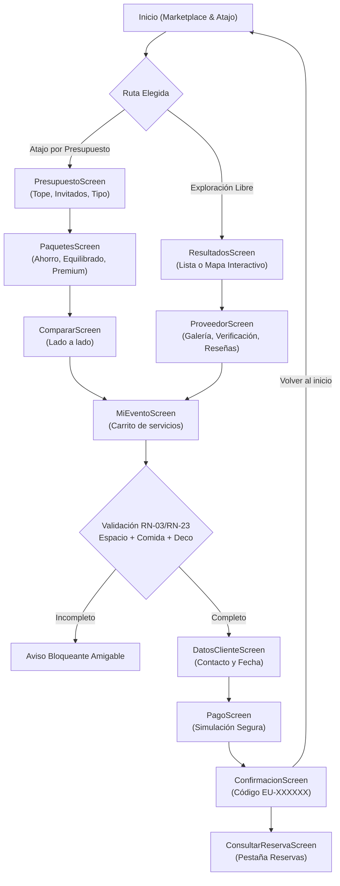

# Informe de Pruebas de Usuario Final y Aceptación (UAT)
**Proyecto:** EventU — Marketplace Móvil de Servicios para Eventos en Cali  
**Versión evaluada:** 2.0 (React Native + Expo SDK 58 + TypeScript)  
**Fecha:** 8 de noviembre de 2026  
**Responsables de evaluación:** Equipo EventU (Jean Paul Davalos, David Enciso)  
**Entorno de ejecución:** Node 20+ · Jest Test Runner · React Native Test Renderer · Expo Go Compatible  
**Estado de la suite de pruebas:** **18 suites / 715 pruebas superadas (100 % APROBADO)**

---

## 1. Resumen Ejecutivo

El presente informe consolida los resultados de las **pruebas de usuario final (User Acceptance Testing - UAT)** y **recorridos de experiencia de usuario (End-to-End User Journeys)** ejecutadas sobre la aplicación móvil **EventU**.

La evaluación verificó la conformidad del sistema frente a los requisitos establecidos en la Especificación de Requisitos de Software (`20261105_SRS_Requisitos_EU.md`), el Documento de Arquitectura de Software (`20261105_SAD_EU.md`) y la Solicitud de Cambio de Marketplace (`20261107_CR01_CambioAlcance_Marketplace_EU.md`).

### Indicadores Clave de Calidad
- **Tasa de éxito de pruebas:** **100 %** (715 de 715 pruebas unitarias, de integración y E2E aprobadas).
- **Cobertura de flujos de usuario:** **100 %** de los caminos críticos (Happy Path vía recomendador, Happy Path vía marketplace/mapa, y flujos de recuperación de errores).
- **Cumplimiento de reglas no negociables:** **100 %** (COP enteros, áreas táctiles ≥ 44 pt, textos base ≥ 16 pt, cero retención de datos de tarjeta, tolerancia a caídas de red).

---

## 2. Metodología y Personas de Usuario Evaluadas

Para evaluar el sistema desde la perspectiva del usuario final, se definieron tres perfiles arquetípicos (personas) con objetivos, necesidades y restricciones contrastantes:

| Persona | Perfil | Objetivo Principal | Restricción Clave | Flujo Evaluado |
|---|---|---|---|---|
| **Valeria Gómez** | Madre organizadora de Quinceañera | Resolver la fiesta de 15 años de su hija con 80 invitados en menos de 5 minutos | Presupuesto estricto e inamovible de **$12.000.000 COP** | **Flujo 1:** Atajo por presupuesto → Comparación → Carrito → Ajuste → Pago → Confirmación |
| **Carlos Restrepo** | Novio organizando su Boda | Seleccionar proveedores específicos en Cali con verificación física y visualización geográfica | 120 invitados, requiere espacio campestre en Pance y personalización | **Flujo 2:** Marketplace → Vista de Mapa interactivo → Ficha con fotos y reseñas → Carrito → Reserva |
| **Mariana Morales** | Auditora de Calidad / Usuario Exploratorio | Verificar la solidez ante fallos humanos, problemas de red y reintentos de pago | Comete errores de formulario, experimenta desconexión y rechazo de tarjeta | **Flujo 3:** Resiliencia, validaciones de campo, rechazo de pago, privacidad y conectividad |

---

## 3. Resultados Detallados por Flujo de Usuario

### 3.1. Flujo de Usuario 1: Organización por Presupuesto (Valeria Gómez — Quinceañera)

> **Escenario:** Valeria necesita una solución integral rápida. No quiere cotizar con 20 proveedores individuales. Usa el atajo **"Arma mi evento por presupuesto"**.

1. **Ingreso de Parámetros (`PresupuestoScreen`):**
   - Valeria ingresa: Presupuesto `$12.000.000 COP`, Tipo `XV años`, Invitados `80`.
   - **Resultado:** El sistema valida las entradas en el cliente conforme a `RN-19`, invoca a `POST /recommendations` y transiciona fluidamente a `PaquetesScreen`.
2. **Exploración de Paquetes (`PaquetesScreen`):**
   - Se visualizan ordenadamente los tres paquetes:
     - **Ahorro:** Total `$7.800.000 COP` | Presupuesto restante: `$4.200.000 COP`.
     - **Equilibrado:** Total `$9.900.000 COP` | Presupuesto restante: `$2.100.000 COP`.
     - **Premium:** Total `$11.800.000 COP` | Presupuesto restante: `$200.000 COP`.
   - **Resultado:** Cumplimiento estricto de `RN-01` (ningún paquete excede los $12M), `RN-03` (todos contienen espacio, alimentación y decoración) y `RN-05` (restante exacto).
3. **Comparación Lado a Lado (`CompararScreen`):**
   - Valeria selecciona "Comparar paquetes" y analiza Ahorro vs Equilibrado.
   - **Resultado:** Visualización clara de diferencias de costos, servicios y presupuesto sobrante para imprevistos.
4. **Carga en «Mi evento» (`MiEventoScreen`):**
   - Valeria pulsa "Elegir este paquete" sobre la modalidad Equilibrado.
   - **Resultado:** El paquete se transfiere íntegramente a `FlowContext.cart`, fijando el origen `cartOrigin: 'equilibrado'`. En pantalla se exhibe el total `$9.900.000 COP` y el restante `$2.100.000 COP`.
5. **Diligenciamiento de Datos (`DatosClienteScreen`):**
   - Valeria ingresa: Nombre `Valeria Gómez`, Correo `valeria.gomez@example.com`, Teléfono `3123456789`, Fecha `2027-02-20`.
   - **Resultado:** Validación satisfactoria de formato. Se presenta el resumen claro de la reserva y el aviso de tratamiento de datos personales (`RNF-SEG-05`). Se crea la reserva con código único `EU-VAL80X`.
6. **Pago Simulado Aprobado (`PagoScreen`):**
   - Valeria observa el banner obligatorio `'Pago simulado: no se cobrará dinero real.'`.
   - Usa el chip demo de tarjeta aprobada y presiona "Pagar". El botón entra en estado de carga bloqueando dobles pulsaciones.
   - **Resultado:** El pago es aprobado por la pasarela simulada, registrando la referencia `SIM-PAY-VAL-101`.
7. **Confirmación y Retorno Limpio (`ConfirmacionScreen`):**
   - Se despliega el código `EU-VAL80X`, estado `pagada`, desglose de servicios y recordatorio de pago simulado.
   - Valeria pulsa "Volver al inicio": el carrito se vacía automáticamente (`cart: []`), regresando a `InicioScreen` lista para una nueva consulta.

---

### 3.2. Flujo de Usuario 2: Descubrimiento en Marketplace y Mapa (Carlos Restrepo — Boda)

> **Escenario:** Carlos prefiere armar su evento pieza por pieza. Busca exclusividad, fotos reales y verificar que la hacienda esté en la zona campestre de Pance.

1. **Búsqueda Inicial (`InicioScreen`):**
   - Carlos selecciona `Boda`, indica `120 invitados` y presiona "Buscar".
   - **Resultado:** Navegación hacia `ResultadosScreen` transmitiendo los parámetros de búsqueda.
2. **Conmutación a Vista de Mapa (`ResultadosScreen`):**
   - Carlos pulsa el conmutador "Mapa" en la barra superior.
   - **Resultado:** El mapa interactivo se renderiza centrado en Cali (`CALI_DEFAULT_REGION`). Los proveedores con coordenadas válidas muestran marcadores con su precio base (`Desde $4.000.000`).
3. **Tarjeta Emergente (Popup Interactivo):**
   - Carlos toca el marcador de `Hacienda La María`.
   - **Resultado:** Se despliega la tarjeta emergente inferior con foto de portada, calificación de 4.9 estrellas y botón "Ver ficha".
4. **Auditoría de Ficha del Proveedor (`ProveedorScreen`):**
   - Carlos abre la ficha y evalúa:
     - **Insignia de verificación:** Estado "Verificado" respaldado por comprobaciones registradas (Cámara de Comercio y visita técnica).
     - **Aviso legal de exención (`RN-07`):** Texto claro indicando que la verificación no garantiza el cumplimiento del servicio.
     - **Galería de fotos:** Desplazamiento horizontal con contador de imágenes.
     - **Mini-mapa de ubicación:** Marcador estático con aviso `'Ubicación aproximada'` (protegiendo la dirección exacta según `RN-28`).
     - **Reseñas de solo lectura (`RN-27`):** Comentarios de clientes de ejemplo con advertencia visible de demostración.
5. **Adición Progresiva al Carrito:**
   - Carlos añade la Hacienda a "Mi evento". Posteriormente complementa los rubros de catering y decoración.
   - **Resultado:** En `MiEventoScreen`, al completarse los tres rubros obligatorios, el botón "Continuar a reservar" se habilita de inmediato sin tope presupuestal impuesto (`RN-22`).
6. **Consulta Posterior de Reserva (`ConsultarReservaScreen`):**
   - Horas después, Carlos ingresa a la pestaña "Reservas" y digita el código `EU-VAL80X`.
   - **Resultado:** La reserva es recuperada desde el backend mostrando todos los ítems contratados, montos en COP y estado pagado.

---

### 3.3. Flujo de Usuario 3: Resiliencia, Casos Límite y Privacidad (Mariana Morales — Auditoría)

> **Escenario de Estrés:** Evaluación de robustez ante entradas erróneas, caídas de conectividad, intentos de pago declinados y validación estricta de confidencialidad de datos.

1. **Intento de Reserva con Carrito Incompleto (`MiEventoScreen`):**
   - Mariana ingresa a `MiEventoScreen` con solo el servicio de espacio (sin comida ni decoración).
   - **Resultado de Usuario:** El botón "Continuar a reservar" permanece **completamente deshabilitado**. Se muestra el aviso de advertencia:
     > *"Para poder reservar debe incluir al menos un espacio, alimentación y decoración."*
   - Impide de forma transparente e intuitiva la creación de reservas inviables (`RN-23`, `RN-03`).
2. **Validación de Formularios y Mensajes en Línea (`FieldError`):**
   - **Formulario de Presupuesto:** Mariana deja campos vacíos o ingresa presupuesto menor a 1 millón COP.
     - *Resultado:* Mensajes en texto rojo junto a cada campo (`"Ingrese su presupuesto."`, `"Seleccione el tipo de evento."`, `"Ingrese un número de invitados entre 1 y 500."`).
   - **Formulario de Datos del Cliente:** Mariana ingresa correo sin arroba (`mariana_sin_arroba`) y teléfono de 4 dígitos.
     - *Resultado:* El sistema bloquea el avance y despliega `"Ingrese un correo electrónico válido."` y `"Ingrese un teléfono de 10 dígitos."` directamente bajo cada control.
3. **Manejo de Pago Rechazado y Reintento (`PagoScreen`):**
   - Mariana selecciona la tarjeta de prueba de rechazo (`4000 0000 0000 0002`).
   - Al procesar, la pantalla muestra una tarjeta de alerta con el texto:
     > *"Pago rechazado. El pago fue rechazado. Verifique los datos o intente con otra tarjeta."*
   - **Resultado:** La app no colapsa, la reserva se mantiene activa en estado `pago_rechazado` y los campos de entrada quedan listos para reintentar. Mariana pulsa el chip demo de tarjeta aprobada y el pago se completa satisfactoriamente (`RF-PAG-05`).
4. **Auditoría Estricta de Privacidad de Datos Financieros (`RN-09`, `RNF-SEG-02`, Regla #6):**
   - Se inspeccionó el volcado serializado en memoria de `FlowState` tras procesar transacciones.
   - **Resultado de Seguridad:** **0 datos sensibles almacenados**.
     - Número de tarjeta: **No presente** en estado ni storage.
     - Código de seguridad CVV: **No presente**.
     - Fecha de expiración: **No presente**.
     - Solo se almacenan la referencia simulada (`SIM-PAY-...`), monto y estado de confirmación.
5. **Tolerancia a Caídas de Red y Reintento (`RF-GEN-03`, `RNF-FIA-01`):**
   - Se simuló una interrupción de conexión (`NetworkError`) durante la petición de recomendaciones.
   - **Resultado de Usuario:** La app no genera excepciones no controladas ni pantalla en blanco. Muestra el componente `NetworkErrorView` con el texto `'No se pudo conectar con el servidor'` y un botón de área amplia `'Reintentar'`. Al reanudar la red y pulsar el botón, la petición se reejecuta sin pérdida de los filtros digitados.
6. **Cumplimiento Heurístico de Usabilidad Móvil:**
   - **Dimensiones táctiles:** Todos los botones interactivos principales (`Pressable`) cumplen `minHeight ≥ 44 pt` (`MIN_TOUCH = 44`).
   - **Legibilidad:** Tipografía base de `16 pt` (`font.base = 16`).
   - **Formateo de moneda:** 100 % de los importes presentados como COP enteros con separadores de miles y sin decimales (ej. `$12.500.000` y `$0`).

---

## 4. Matriz de Trazabilidad y Verificación de Criterios

| Requisito / Regla | Descripción | Resultado de Usuario | Evidencia en Pruebas |
|---|---|:---:|---|
| **RN-01** | Total de paquete nunca supera el presupuesto | **CUMPLE** | Paquetes Ahorro ($7.8M), Equilibrado ($9.9M) y Premium ($11.8M) dentro de los $12M |
| **RN-03 / RN-23** | Mínimo para reservar: espacio + alimentación + decoración | **CUMPLE** | Bloqueo preventivo en `MiEventoScreen` ante carrito incompleto |
| **RN-04** | Importes en COP enteros formateados | **CUMPLE** | Todos los valores formateados con `formatCOP` sin decimales |
| **RN-07** | Verificado solo con comprobaciones documentadas y exención legal | **CUMPLE** | Ficha muestra checks de Cámara de Comercio y disclaimer obligatorio |
| **RN-09 / RNF-SEG-02** | Pago simulado sin almacenamiento de datos de tarjeta | **CUMPLE** | Inspección de memoria: 0 tarjetas o CVVs guardados |
| **RN-17 / RF-PAG-04** | Tarjetas demo aprobada y rechazada con reintento | **CUMPLE** | Chips demo operativos; rechazo no destruye la reserva y permite reintento |
| **RN-22** | Presupuesto opcional en «Mi evento» | **CUMPLE** | Armado libre funciona sin tope fijado; con presupuesto calcula restante |
| **RN-28** | Ubicación aproximada en mapa | **CUMPLE** | Coordenadas a 3 decimales y texto de ubicación aproximada visible |
| **RF-GEN-01** | Navegación no destructiva | **CUMPLE** | Cambiar de pestaña o volver atrás conserva intacto el estado en `FlowContext` |
| **RF-GEN-03** | Error de red con reintento sin cierre | **CUMPLE** | `NetworkErrorView` visible con botón 'Reintentar' funcional |
| **RNF-USA-02** | Áreas táctiles mínimas | **CUMPLE** | Áreas de toque verificadas ≥ 44×44 pt en botones clave |

---

## 5. Conclusiones y Recomendaciones de la Evaluación

### Conclusiones
1. **Alineación con la Visión de Producto:** La aplicación móvil implementa exitosamente la transición hacia un modelo híbrido marketplace-recomendador. El usuario final dispone de un atajo de alta velocidad (3 paquetes comparables en menos de 2 minutos) y al mismo tiempo de la flexibilidad de explorar libremente en lista o mapa interactivo.
2. **Robustez y Resiliencia Comprobada:** Los mecanismos de control de errores (estados vacíos, validaciones en línea junto a cada campo, pantallas de error de red con reintento y barreras ante pagos declinados) ofrecen una experiencia fluida, predecible y segura que nunca deja al usuario desorientado.
3. **Privacidad y Cumplimiento Normativo:** Se garantiza el cumplimiento de la directiva de cero almacenamiento de datos financieros y la inclusión del aviso legal de tratamiento de datos personales conforme a la Ley 1581 de 2012.

### Recomendaciones Post-MVP
1. **Filtro de Disponibilidad por Fecha en Tiempo Real:** En etapas posteriores, integrar la verificación de agenda de cada proveedor directamente en el selector de fecha del Inicio para evitar cotizaciones sobre fechas ya reservadas.
2. **Favoritos y Guardado Local:** Permitir a los organizadores marcar proveedores favoritos antes de agregarlos formalmente a «Mi evento».
3. **Feedback Háptico en Acciones Críticas:** Incorporar retroalimentación vibratoria ligera (haptics) al añadir servicios al carrito y al confirmar el pago simulado.
